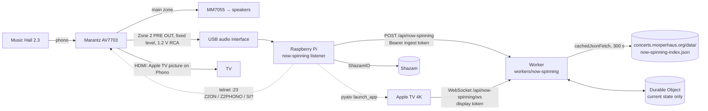
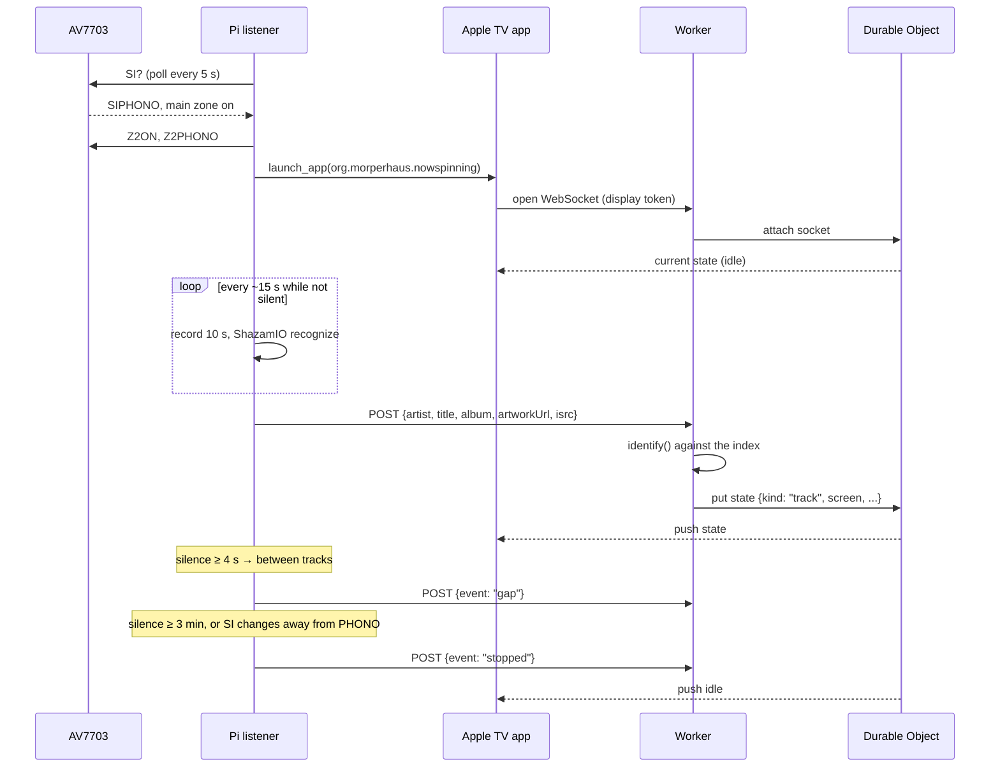

# Now Spinning

**Status:** Planned
**Target Version:** v7.0.0
**Priority:** Medium
**Estimated Complexity:** Very High (hardware, a Python listener, a new Worker with a Durable Object, a tvOS app)
**Dependencies:** None in code. Hardware has to be bought and installed before Phase 3 (see [Hardware](#hardware-to-order)).

**Kit in this folder:**
- [`HANDOFF.md`](HANDOFF.md): the original brief and the confirmed AV setup
- [`mock/index.html`](mock/index.html): the TV-screen mock. Its `identify()` is the reference lookup.
- [`mock/build_mock_data.py`](mock/build_mock_data.py): builds the mock's `data.json`. It's the prototype of the index builder in §Data.
- [`screens/`](screens/): one screenshot per screen state

---

## Executive Summary

When a record plays on the living-room turntable, the TV shows the song, its album, and the
archive's connection to it: the nights Mike heard it live, with his photos from those nights.
Every concert in the archive is a night Mike was there, so this puts that history next to
music he's playing now, without picking up a phone or opening the site.

It is an extension of the archive, not a scene on the website. The pieces are a Raspberry Pi
that listens to the receiver's line-level Zone 2 output, a new Worker on
`concerts.morperhaus.org` that runs the archive lookup and holds the current state, and a
tvOS app that shows it. The site itself doesn't change, apart from one generated data file.

**Decided (2026-11-21):**

| Question | Decision |
|---|---|
| Where it lives | Everything (Worker, Pi listener, tvOS app, docs) in this repo, on `feat/now-spinning`. Hardware and Xcode tasks are tracked as GitHub issues. |
| Cloud or local | **Cloud.** The Worker plus a Durable Object holds the state. The Pi only captures and identifies. |
| Zone 2 | Free to use. |
| Video routing | Already done: the AV7703 sends the Apple TV picture to the TV while Phono plays. |
| Play history | **None.** No log of vinyl plays is kept anywhere (see [Privacy](#privacy)). |

---

## 🚀 Implementation Quick Start

**Copy/paste this prompt when starting a NEW Claude Code session (no prior context):**

```
I need to implement the Now Spinning feature for Morperhaus Concerts.

**IMPORTANT CONTEXT WINDOW MANAGEMENT:**
- This is a fresh session with NO prior context about the project
- You have access to the full codebase and can read any files
- At the end of EACH implementation window, you MUST:
  1. Assess remaining context window capacity
  2. If <30% remains, STOP and ask if I want to continue in a new session
  3. Provide a handoff summary for the next session
- Implement the spec AS WRITTEN - it's the source of truth
- Ask clarifying questions if anything is ambiguous

**Feature Overview:**
- A Raspberry Pi hears the turntable through the AV7703's Zone 2 line output and identifies songs (ShazamIO)
- It POSTs {artist, title, album?, artworkUrl?, isrc?} to a new Worker at concerts.morperhaus.org/api/now-spinning
- The Worker runs the archive lookup (port of identify() in the mock) and stores only the current state in a Durable Object
- A tvOS SwiftUI app holds a WebSocket to the Worker and renders one of five screen states
- No play history is kept, anywhere

**Key References:**
- Full Design Spec: docs/specs/future/global-now-spinning/global-now-spinning-spec.md
- Reference lookup + layout: docs/specs/future/global-now-spinning/mock/index.html
- Worker patterns to copy: workers/mcp-server (wrangler.toml, data.ts cachedJsonFetch, aliases.ts, CI workflow)
- Secrets inventory: docs/SECRETS.md
- Data skill: .claude/skills/data-schema/SKILL.md
- Media rules: .claude/skills/media-pipeline/SKILL.md

**Implementation Approach:**
- Window 1: Index builder + Worker lookup (pure identify.ts with fixture tests)
- Window 2: Worker API, Durable Object, auth, CI workflow
- Window 3: Pi listener (Python), runnable against a WAV file without hardware
- Window 4: tvOS app (needs Xcode on Mike's Mac)

Let's start with Window 1. Should I begin with scripts/build-now-spinning-index.ts?
```

---

## Design Philosophy

The record comes first; the archive comments on it. The screen should feel like a sleeve
on a shelf, not a dashboard: one song, one sentence about Mike's history with it, a few
nights, and photos from those nights drifting behind. It has to read from the couch, look
fine left on for an hour, and say nothing it can't back up. "Never heard it live" appears only
when every one of those nights has a setlist.

---

## Architecture



### Sequence: a record plays



### Why cloud (and what that costs)

The cloud keeps the archive lookup in one place. The Worker reads the same published data the
site does, so it can't drift from the site, and nothing has to be copied to the Pi when the
archive changes. Without the internet the screen stops working, though the record still plays
normally. That trade is acceptable for a display that adds to listening rather than replacing
any part of it.

---

## Data

### A prebuilt index, not raw files

The lookup needs songs from **every** setlist (openers included), the alias groups, albums,
covers, photos, and which nights have setlists. The raw files add up to about 1.9 MB. The mock's
compact `data.json` is 360 KB and holds everything the lookup needs.

Add `scripts/build-now-spinning-index.ts`, a TypeScript port of
`mock/build_mock_data.py` without the photo resizing, and call it from `npm run build-data`. It
writes `public/data/now-spinning-index.json`:

```ts
interface NowSpinningIndex {
  generatedAt: string;
  albums: { t: string; y: string; c: string | null }[];        // c: 600x600 cover URL
  songs: { n: string; a: string; d: string[]; al: number | null }[]; // a: billing slug, d: dates
  artists: Record<string, { n: string; i: string | null; s: [date: string, venue: string, city: string, role: 'h' | 'o'][] }>;
  canon: Record<string, string>;                                // sameAct billing → canonical
  photos: Record<string, string[]>;                             // "date|billing" → site-relative image URLs, max 3
  sl: string[];                                                 // "date|billing" with a setlist
  cv: Record<string, [song: string, performer: string, date: string][]>; // loose(original artist) → covers heard
}
```

Rules carried over from the mock and the handoff:
- Normalize with `normalizeArtistName` from `src/utils/normalize.ts`.
- Songs come from `setlists-cache.json`, **not** `song-index.json`, which only holds headliners:
  2,267 songs against 1,720. Skip `tape` entries. Fixing `song-index.json` itself is a
  separate issue, because Ask the Archive and the MCP server have the same gap.
- Merge `sameAct` billings; keep `sharesMember` acts separate.
- Album covers: `album-covers.json` mzstatic `100x100bb` → `600x600bb`. Fall back to
  Cover Art Archive `front-500` when `coverAvailable`.
- Photos: `media-index.json` assets with `subject: 'artist'` and `kind: 'image'`, keyed `date|artistNormalized`,
  up to 3 per night, in `order` order. Use the site URLs as they are; the tvOS app loads
  `https://concerts.morperhaus.org/images/shows/…`. Follow `.claude/skills/media-pipeline/SKILL.md`:
  only published assets, no new derivatives.
- Add the file to whatever `validate` checks for generated data, so a stale index fails CI.

### Lookup (`workers/now-spinning/src/identify.ts`)

A pure function, `identify(index, input) → NowSpinningState`, ported from the mock's
`identify()` and `render()` branch logic. Copy `buildAliasIndex`/`canonicalSlug` from
`workers/mcp-server/src/aliases.ts`; workers are self-contained npm packages and none import
from another.

Matching rules:
1. **Artist:** try the name exactly as Shazam gives it (slug, then loose), and only then the
   cleaned name with `feat./featuring/ft./with/&/and …` stripped. Doing it in the other order
   turns "Echo and the Bunnymen" into "Echo". That bug was in the original mock and is fixed in
   this kit. `loose()` drops a leading "the" and every "and", so "Echo & the Bunnymen" matches the
   archive's "Echo and the Bunnymen". The index builder must use the same `loose()`.
2. **Title:** strip Shazam's noise (parentheticals and brackets, `- … Remaster/Live/Version/Mix/Edit/Mono/
   Stereo/Single/Demo/Bonus`) from both sides and compare loose. Because both sides get the same
   cleaning, titles that start with a parenthetical, like "(Don't Fear) The Reaper", still match.
   Cover these in tests.
3. **Billings:** collect every billing of the canonical act (Brian Setzer has four).
4. **Album:** the archive's album when it has one; otherwise the album and artwork Shazam sent.
   The mock accepted `extra.album` but never received it. The Worker must pass it through.

### Screen states

| # | `screen` | When | Headline (from the mock) | Photos from |
|---|---|---|---|---|
| 1 | `heard` | Song is on a setlist from a night Mike was there | "You've heard this one live N times." / "…once." | the nights it was heard |
| 2 | `seen` | Artist seen, song not on any setlist | "never heard this one live" **only if every night has a setlist**; otherwise "maybe" copy | every night the artist was seen |
| 3 | `cover-of-this` | Artist never seen, but someone else played this song | "You've never seen X. But you've heard this one live, played by Y." | those nights |
| 4 | `covers` | Artist never seen, others played other songs of theirs | "…you've heard N of their songs live, in other hands." | those nights |
| 5 | `none` | No connection | "Not in the archive. Yet." | none (the screen takes its colour from the record) |

Plus three states that aren't songs:

| `kind` | When | Screen |
|---|---|---|
| `idle` | Nothing playing (default; after `stopped`) | Brand mark, dimmed, and a small "Put a record on." line. No clock or other data. |
| `gap` | Between tracks or while flipping sides | Keep the last track's screen. After 90 s, fade the text and keep the sleeve and spinning record. |
| `unmatched` | Sound present, Shazam has no match after 3 tries | "Listening…" with the generic sleeve. Never guess. |

Copy for every state comes from the mock. It follows `.claude/skills/liner-notes-voice/SKILL.md`:
"you" addresses Mike, plainly, with no hype.

---

## Worker API (`workers/now-spinning`)

New self-contained Worker, matching `workers/mcp-server`: its own `package.json`, `vitest.config.ts`,
`wrangler.toml`, and a path-filtered CI workflow `.github/workflows/now-spinning-ci.yml`.

- Route: `concerts.morperhaus.org/api/now-spinning*`. It's more specific than meta-injector's `/*`, like `/api/ask*`.
- `[vars] DATA_BASE_URL = "https://concerts.morperhaus.org/data"`. Load the index with
  `cachedJsonFetch` (300 s TTL), so the screen reflects an archive update within about 5 minutes
  of deploy.
- One SQLite-backed Durable Object class `NowSpinningRoom`, one instance (`idFromName("living-room")`).

| Method + path | Auth | Body / response |
|---|---|---|
| `POST /api/now-spinning` | `Authorization: Bearer <NOW_SPINNING_INGEST_TOKEN>` | Body: `{ event: "track", artist, title, album?, artworkUrl?, isrc?, shazamId? }` or `{ event: "gap" \| "unmatched" \| "stopped" }`. Returns the new state. `400` on a bad body, `401` without the token. |
| `GET /api/now-spinning` | `Bearer <NOW_SPINNING_DISPLAY_TOKEN>` | Current `NowSpinningState` (used for polling fallback and debugging) |
| `GET /api/now-spinning/ws` | display token, sent as `Sec-WebSocket-Protocol` or `?token=` | WebSocket. Sends the current state on connect, then each change. Uses DO WebSocket hibernation so an idle evening costs nothing. |

```ts
type NowSpinningState =
  | { kind: 'idle'; at: string }
  | { kind: 'unmatched'; at: string }
  | { kind: 'track' | 'gap'; at: string; track: {
      title: string; artist: string; album: { title: string; year?: string; coverUrl?: string } | null;
      screen: 'heard' | 'seen' | 'cover-of-this' | 'covers' | 'none';
      headline: string; subline?: string; count?: number;
      nights: { date: string; venue: string; city: string; role: 'h' | 'o'; label?: string; hasPhotos: boolean }[];
      moreNights: number;
      photos: { url: string; date: string; venue: string }[]; // absolute URLs, newest night first, max 5
      accentHue: number;  // hue() from the mock, for the generated sleeve and glow
    } };
```

The Worker builds the headline and nights text, so the tvOS app only lays them out. A copy change
then ships with a Worker deploy, with no App Store or TestFlight build.

**Durable Object storage holds exactly one value, the current state, and overwrites it.**
No history, no list, no Analytics Engine rows naming songs. Keep it to `console.log` of the
state *kind* only. Repeated POSTs of the same track (same `shazamId`, or the same artist and title) are
ignored, so a long song doesn't make the screen redraw.

**Secrets** (add both to `docs/SECRETS.md`'s matrix):

| Secret | Homes |
|---|---|
| `NOW_SPINNING_INGEST_TOKEN` | prod `wrangler secret`, `workers/now-spinning/.dev.vars`, Pi `/etc/now-spinning/env` |
| `NOW_SPINNING_DISPLAY_TOKEN` | prod `wrangler secret`, `.dev.vars`, tvOS app (in the Keychain, entered once on first launch, not compiled in) |

There are two tokens so the TV can't write and a leaked Pi token can't read. The display token
exists because the current state says what's playing in your house right now.

---

## Pi listener (`now-spinning/pi/`)

Python 3.12 service, run by systemd (`now-spinning.service`, restart on failure). Config is in
`/etc/now-spinning/env`: the Worker URL, the ingest token, the AVR host, the Apple TV identifier,
and the audio device.

**Gating on the receiver.** Use telnet on port 23 (the Denon/Marantz control protocol; the
`denonavr` library supports it). Poll `PW?` and `SI?` every 5 s, or subscribe to events.
- Main zone on and `SI` = `PHONO` → send `Z2ON`, `Z2PHONO`, then start listening and try to
  launch the app on the Apple TV.
- `SI` moves away from `PHONO`, or main zone off → POST `stopped`, stop listening, send `Z2OFF`
  (only if the listener turned Zone 2 on).
- The listener never touches the main zone.

**Launching the Apple TV app.** Pair once with pyatv over the Companion protocol, then
`launch_app("org.morperhaus.nowspinning")` when Phono starts. Do it only if the app isn't already in the
foreground (`app.identifier`), so a show Mike is watching on the Apple TV doesn't get replaced
when someone switches inputs. **Not confirmed on tvOS 26 or the 2026 Apple TV yet**, so test it
in Phase 3 with the hardware. If Apple has closed it off, the fallback is manual: the app is
pinned in the top row, and opening it while a record plays shows the current state right away.

**Identification loop.**
- Capture 44.1 kHz stereo from the USB interface (`sounddevice`), and downmix to mono for recognition.
- Silence gate: RMS below −50 dBFS for ≥ 4 s → POST `gap` once. Below −50 dBFS for ≥ 3 min → `stopped`.
  Tune the threshold against surface noise from a real record, which is louder than digital silence.
- While there's sound: record a 10 s clip, run `shazamio` `recognize`, and wait about 15 s between clips.
  If the result differs from the current track, POST `track`. Ignore the same track. No match three
  times in a row → POST `unmatched` once.
- Clips stay in memory and are never written to disk.
- Network failures: retry with backoff. The listener never crashes because the Worker is down.

**Testing without hardware.** `python -m now_spinning --wav sample.wav --dry-run` runs the
loop on a file and prints what it would POST. Unit-test the silence gate and the
same-track check with synthetic audio.

**ShazamIO risk.** ShazamIO is an unofficial client for Shazam's private API. It can break or be
blocked without notice. Keep recognition behind one `Recognizer` interface so ACRCloud or AudD,
which are paid but official, can replace it with a config change. Check that `shazamio-core` has
an aarch64 wheel for the Pi's Python before buying anything. If not, it builds from Rust source.

---

## tvOS app (`now-spinning/tvos/`)

SwiftUI, tvOS 26, bundle `org.morperhaus.nowspinning`. Built and signed on Mike's Mac.
CI can't build it, so Xcode tasks are GitHub issues.

- **Connection:** `URLSessionWebSocketTask` to `/api/now-spinning/ws`. If the socket drops,
  reconnect with backoff and meanwhile poll `GET /api/now-spinning` every 10 s. The app keeps no
  local cache of archive data. Everything comes in the state, so archive refreshes reach the TV
  with the Worker's 5-minute cache.
- **Layout:** a 1920×1080 point canvas, copied from `mock/index.html`: sleeve and spinning record on
  the left, text column on the right, photo strip bottom-left, brand bottom-right. Fonts are
  Playfair Display (title, big count) and Source Sans 3, bundled in the app. Colours are the mock's
  `--ink/--dim/--faint/--accent` on the `#181334 → #2c1660` gradient. These match the site's dark
  scenes (`.claude/skills/design-system/SKILL.md`).
- **Motion:** the record spins at 33⅓ rpm (1.8 s per turn in the mock). On a new track it slides out and back
  in (0.9 s). Text fades up (0.9 s). Background photos crossfade every 7 s. Turn the motion off when
  tvOS Reduce Motion is on.
- **Screen burn and sleep:** set `isIdleTimerDisabled = true` while the state is `track`, `gap` or
  `unmatched`; set it back to `false` on `idle` so the Apple TV screensaver can take over. Shift the idle screen's
  position slightly every few minutes.
- **Remote:** Menu exits. Nothing else is interactive in v1.
- **First launch:** a one-time screen to enter the display token, stored in the Keychain.

---

## Hardware to order

| Item | Pick | Notes |
|---|---|---|
| Computer | Raspberry Pi 5, 2 GB | Plenty for capture plus a 10 s recognition every 15 s. A Pi 4 works if one's on hand. |
| Power | Official Raspberry Pi 27 W USB-C supply | Underpowered Pis drop USB audio. |
| Storage | 32 GB A2 microSD | Raspberry Pi OS Lite, 64-bit |
| Case | Official Pi 5 case with fan | It sits in an AV cabinet; keep it cool. |
| Audio in | Behringer UCA202 / UCA222 (RCA line in, USB, class-compliant) | **Check:** its input sensitivity is consumer level (−10 dBV), and the AV7703's pre-outs are rated 1.2 V. Set the Zone 2 fixed level low enough that peaks stay around −12 dBFS. If it clips at the lowest usable setting, use a HiFiBerry DAC+ADC Pro instead. |
| Cable | RCA stereo pair, 1 m | AV7703 ZONE2 PRE OUT L/R → interface IN |
| Network | Ethernet patch cable to the cabinet switch | Wi-Fi works too; wired is steadier. |

**Shelf placement:** next to the AV7703, with the interface on a short USB lead so the RCA run stays
short and away from the amp's power cables (hum).

**Receiver setup, once:**
- Zone 2 Setup → Volume Level: fixed.
- Confirm that the AV7703, not just the near-identical AV7702, can send Phono to Zone 2.
- Turn on network control (Network → Network Control: Always On) so telnet works while the receiver is in standby.

---

## Privacy

- The Pi only listens to the receiver's line output. There is no microphone anywhere. It hears
  exactly what the Phono input plays, and only while the main zone is on Phono.
- Audio clips live in memory for one recognition call and go to Shazam (or a replacement
  provider). Nothing is written to disk.
- **No play history.** The Worker keeps only the current state and overwrites it. Nothing is logged
  per song, and nothing goes to Analytics Engine or GA4. Turning the record off erases the last
  track.
- Reading the current state requires the display token. Nothing about it is public on the site.

---

## Testing Strategy

**Worker (vitest, `now-spinning-ci.yml`)**: build a fixture index from the real `public/data`
in the test, the way `workers/ask-chat/src/chips.test.ts` imports the data files. Then assert:
- [ ] Each of the five screens using the mock's sample picks: Social Distortion "Ring of Fire", Depeche Mode
      "Everything Counts (Remastered 2006)" → heard 5×, "Barrel of a Gun" → seen 5×, never heard
      (all 5 nights have setlists), Bowie "Let's Dance - 2018 Remaster" → `cover-of-this`
      (Nile Rodgers, Heaven 17), Rolling Stones "Paint It Black" → `covers`, Fleetwood Mac "Dreams" → `none`
- [ ] Opener songs are found: Blancmange "Blind Vision - Single Version" → heard once (Sep 16, 2026)
- [ ] Billings with "and"/"&" resolve: "Echo & the Bunnymen", "Echo and the Bunnymen", "Siouxsie and the Banshees",
      "Joan Jett & The Blackhearts", plus "Depeche Mode feat. X"
- [ ] `sameAct` merge: "Brian Setzer" sees all four billings. A `sharesMember` act stays separate.
- [ ] "Maybe" copy appears when some nights lack setlists
- [ ] Shazam's album and artwork are used when the archive has none
- [ ] POST without the token → 401; GET with the ingest token → 401; a repeated track doesn't change `at`
- [ ] The DO holds one key after a hundred POSTs

**Index builder**: its counts match the mock's builder (2,267 songs, 260 artists, 211 covered
artists as of 2026-11-21).

**Pi**: pytest for the silence gate, the same-track check and the gating state machine (fake
telnet). Run `--wav --dry-run` before any hardware arrives.

**On the hardware**
- [ ] Zone 2 level: peaks around −12 dBFS on a loud record, with no clipping
- [ ] The listener stays quiet with main zone on another input
- [ ] Side flip → `gap`, then the first track of side B shows
- [ ] Needle up for 3 min → idle; the Apple TV screensaver comes back
- [ ] App launch: input set to Phono → the app opens (or the manual fallback works)
- [ ] Worker unreachable → the listener keeps running; the TV shows the last state and reconnects

---

## Implementation Plan

### Phase 1: Index and lookup (Window 1)
**Create:** `scripts/build-now-spinning-index.ts`, `workers/now-spinning/{package.json,tsconfig.json,vitest.config.ts}`,
`workers/now-spinning/src/{identify.ts,identify.test.ts,aliases.ts,types.ts}`
**Modify:** `scripts/build-data.ts` (call the builder), `public/data/now-spinning-index.json` (generated)
**Done when:** the lookup tests above pass and the builder's counts match the mock's.

### Phase 2: Worker API (Window 2)
**Create:** `workers/now-spinning/src/{index.ts,room.ts,auth.ts,*.test.ts}`, `workers/now-spinning/wrangler.toml`,
`.github/workflows/now-spinning-ci.yml`, `workers/now-spinning/.dev.vars.example`
**Modify:** `docs/SECRETS.md`, `test/README.md` (list the new Worker's CI)
**Done when:** API and auth tests pass in CI. Deploying (`wrangler deploy` and setting secrets) is Mike's step.

### Phase 3: Pi listener (Window 3)
**Create:** `now-spinning/pi/{pyproject.toml,now_spinning/*.py,tests/,now-spinning.service,README.md}`
**Done when:** `--wav --dry-run` prints the right POSTs and pytest passes. Then on hardware: the checklist above.

### Phase 4: tvOS app (Window 4, on Mike's Mac)
**Create:** `now-spinning/tvos/NowSpinning.xcodeproj` and its SwiftUI sources, with `StateClient` (WebSocket and poll)
and one view per `screen`, plus a SwiftUI preview of each mock sample state.
**Done when:** the six previews match `screens/`, and the app follows a live record.

### GitHub issues to open (outside this code base)
- Order hardware (table above)
- AV7703: confirm Phono → Zone 2, set the fixed Zone 2 level, turn on network control
- Apple TV: pair pyatv (Companion), and check `launch_app` on tvOS 26
- Xcode: create the tvOS target and signing; TestFlight or a direct install to the Apple TV
- Separate: `song-index.json` drops opening acts' songs (affects Ask the Archive and the MCP server)

---

## Future Enhancements

- Show the night's setlist with the current song highlighted (a deep link to `&show=YYYY-MM-DD`).
- Upcoming shows for the artist (Ticketmaster), if Mike wants it on the TV.
- Line out from a CD player or another analog source. The same pipeline works for any input routed to Zone 2.

---

## Questions for Review

- App launch: if pyatv `launch_app` no longer works on tvOS 26, is opening it by hand acceptable, or
  should we look at a Shortcuts or HomeKit automation?
- Is "Listening…" right for `unmatched`, or should the screen stay on idle until a match comes in?

---

## Revision History

- **2026-11-21:** Initial specification created from the Now Spinning spec kit (HANDOFF.md, mock, screens).
  Mock fixes: `findArtist()` tries the full billing before stripping "and/&" names, and `loose()` treats
  "&" and "and" alike.
- **Version:** 1.0.0
- **Author:** Mike Morper, with Claude Code
- **Status:** Planned
