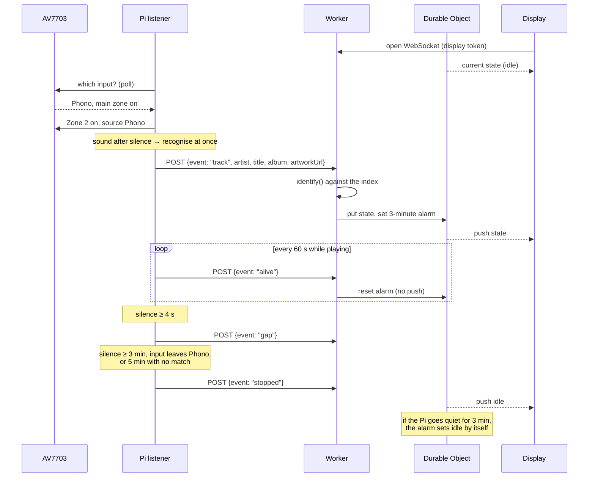

# Now Spinning

**Status:** Planned
**Target Version:** v7.0.0
**Priority:** Medium
**Estimated Complexity:** Very High (hardware, a Python listener, a new Worker with a Durable Object, a display)
**Dependencies:** Phase 0 (a hardware evening) comes before any code. Hardware has to be bought before Phase 4.

**Kit in this folder:**
- [`HANDOFF.md`](HANDOFF.md): the original brief and the confirmed AV setup. Where it differs from this spec, the spec wins.
- [`mock/index.html`](mock/index.html): the TV-screen mock. Its `identify()` and `render()` are the reference for the lookup and the copy.
- [`mock/build_mock_data.py`](mock/build_mock_data.py): builds the mock's `data.json`. It's the prototype of the index builder in §Data.
- [`screens/`](screens/): one screenshot per screen state

---

## Executive Summary

When a record plays on the living-room turntable, the TV shows the song, its album, and the
archive's connection to it: the nights Mike heard it live, with his photos from those nights.
Every concert in the archive is a night Mike was there, so this puts that history next to
music he's playing now, without picking up a phone or opening the site.

It is an extension of the archive, not a scene on the website. The pieces are a Raspberry Pi
that listens to the receiver's line-level Zone 2 output, a new Worker on
`concerts.morperhaus.org` that runs the archive lookup and holds the current state, and a
display that shows it.

**Decided:**

| Question | Decision |
|---|---|
| Where it lives | Everything (Worker, Pi listener, display, docs) in this repo. Hardware and Xcode tasks are tracked as GitHub issues. |
| Cloud or local | **Cloud.** The Worker plus a Durable Object holds the state. The Pi only captures and identifies. |
| Zone 2 | Free to use. |
| Video routing | Already done: the AV7703 sends the Apple TV picture to the TV while Phono plays. |
| Play history | **None.** No log of vinyl plays is kept anywhere (see [Privacy](#privacy)). |
| What v7.0.0 means | The index, the Worker, the web display and the Pi listener working end to end. A tvOS app is not part of the release gate. |

**Open (decide after Phase 3):** whether the picture comes from the Pi over HDMI or from a
tvOS app. See [Display](#display).

---

## 🚀 Implementation Quick Start

**Copy/paste this prompt when starting a NEW Claude Code session (no prior context):**

```
I need to implement the Now Spinning feature for Morperhaus Concerts.

**IMPORTANT CONTEXT WINDOW MANAGEMENT:**
- This is a fresh session with NO prior context about the project
- You have access to the full codebase and can read any files
- At the end of EACH implementation window, you MUST:
  1. Assess remaining context window capacity
  2. If <30% remains, STOP and ask if I want to continue in a new session
  3. Provide a handoff summary for the next session
- Implement the spec AS WRITTEN - it's the source of truth
- Ask clarifying questions if anything is ambiguous

**Feature Overview:**
- A Raspberry Pi hears the turntable through the AV7703's Zone 2 line output and identifies songs (ShazamIO)
- It POSTs {artist, title, album?, artworkUrl?, isrc?} to a new Worker at concerts.morperhaus.org/api/now-spinning
- The Worker runs the archive lookup (port of identify() in the mock) and stores only the current state in a Durable Object
- A web page (and later, maybe, a tvOS app) holds a WebSocket to the Worker and renders the state
- No play history is kept, anywhere
- The screen never says something the data can't back up

**Key References:**
- Full Design Spec: docs/specs/future/global-now-spinning/global-now-spinning-spec.md
- Reference lookup + layout + copy: docs/specs/future/global-now-spinning/mock/index.html
- Worker patterns to copy: workers/mcp-server (wrangler.toml, data.ts cachedJsonFetch, CI workflow with its deploy job)
- Build-time generator precedent: scripts/gen-mcp-landing.ts
- Secrets inventory: docs/SECRETS.md
- PR conventions: .claude/skills/steward/SKILL.md
- Data skill: .claude/skills/data-schema/SKILL.md
- Media rules: .claude/skills/media-pipeline/SKILL.md

**Implementation Approach:**
- Phase 0 (Mike, hardware evening): must be done and recorded in this spec before Window 3
- Window 1: match module + index builder + pure identify() with fixture tests
- Window 2: Worker API, Durable Object, auth, liveness, CI + deploy
- Window 3: web display page
- Window 4: Pi listener (Python), runnable against a WAV file without hardware
- Window 5 (optional): tvOS app, only if the display decision goes that way

Let's start with Window 1. Should I begin with workers/now-spinning/src/match.ts?
```

---

## Design Philosophy

The record comes first; the archive comments on it. The screen should feel like a sleeve
on a shelf, not a dashboard: one song, one sentence about Mike's history with it, a few
nights, and photos from those nights drifting behind. It has to read from the couch and look
fine left on for an hour.

**The honesty rule.** The screen never states what the data can't back up. In practice:
- "Never heard this one live" appears only when every night Mike saw the act has a setlist
  **and** nobody else played the song at a show he was at.
- A song heard only inside a medley is counted, and the night says "in a medley".
- A photo's caption always names the night it is from.
- If the lookup itself fails, the screen shows the song and says nothing about the archive.

---

## Architecture

```mermaid
flowchart LR
  TT[Music Hall 2.3] -->|phono| AVR[Marantz AV7703]
  AVR -->|main zone| AMP[MM7055 → speakers]
  AVR -->|Zone 2 PRE OUT, fixed level,<br/>RCA → 1/4" TS| USB[Mackie Onyx Blackjack<br/>USB audio interface]
  USB --> PI[Raspberry Pi<br/>now-spinning listener]
  PI -.->|network control<br/>input + Zone 2| AVR
  PI -->|ShazamIO| SZ[(Shazam)]
  PI -->|POST /api/now-spinning<br/>Bearer ingest token| W[Worker<br/>workers/now-spinning]
  W -->|cachedJsonFetch, 300 s| D[(concerts.morperhaus.org/data/<br/>now-spinning-index.json)]
  W <--> DO[(Durable Object<br/>current state only)]
  DISP[Display<br/>web page, or tvOS app] -->|WebSocket /api/now-spinning/ws<br/>display token| W
  DISP -->|HDMI| AVR
  AVR -->|HDMI, video select on Phono| TV[TV]
```

### Sequence: a record plays



### Why cloud (and what that costs)

The cloud keeps the archive lookup in one place. The Worker reads the same published data the
site does, so it can't drift from the site, and nothing has to be copied to the Pi when the
archive changes. Without the internet the screen stops working, though the record still plays
normally. That trade is acceptable for a display that adds to listening rather than replacing
any part of it.

---

## Phase 0: one hardware evening, before any code

Three assumptions decide whether this design works, and none can be tested from a desk. Test
them first with a laptop (or the Pi, if it has arrived), the Onyx Blackjack, and the Apple TV.
Record the results in this spec's revision history.

| # | Check | Why it matters |
|---|---|---|
| 1 | AV7703: Phono plays out of ZONE2 PRE OUT. Set the Blackjack (see [Audio interface settings](#audio-interface-settings)), then find a fixed Zone 2 level where the loudest record peaks near −12 dBFS and the SIG/OL lights never turn red. | Phono to Zone 2 is confirmed only for the near-identical AV7702 |
| 1b | On the Pi: `arecord -l` lists the Blackjack, and `arecord -D plughw:<card> -f cd -d 10 t.wav` records both channels (`plughw` converts from whatever bit depth the Blackjack offers) | It works without drivers on a Mac, which points to USB Audio Class; this confirms Linux sees it the same way |
| 1c | On the Pi: `vcgencmd get_config usb_max_current_enable` reads 1, and `dmesg` shows no USB over-current or power warnings with the Blackjack plugged in. If it reads 0 with the kit's supply, the Pi didn't recognise the supply as 5 A; set `usb_max_current_enable=1` in `/boot/firmware/config.txt` **only** if the supply is rated 5 V / 5 A. | The Blackjack draws its power from the Pi's USB ports |
| 2 | Run `shazamio` on ten records: an old pressing, a live album, an album with no gaps between tracks, a 45, something obscure. Note the hit rate, the time to first match, and what Shazam calls each artist and title. | The whole feature rests on this. Turntable speed drift and surface noise are the unknowns. |
| 3 | Leave the needle in the run-out groove and watch the level | The Music Hall has no auto-lift, so the click may never read as silence |
| 4 | With the receiver on Phono, wake the Apple TV. Does the receiver switch input to it? | If HDMI Control (CEC) does that, waking the Apple TV stops the record |
| 5 | From the laptop: `pyatv` pairing, `turn_on`, `launch_app` against tvOS 26 | Only matters if the display is a tvOS app |
| 6 | Does anything else (Home Assistant, a control app) hold the receiver's telnet port? | These receivers are believed to accept one telnet client at a time |
| 7 | Confirm what `shazamio` sends to Shazam (a fingerprint, or audio) | So the privacy section states a fact |

If check 2 fails, stop and pick another recogniser (ACRCloud, AudD) before going further.

---

## Data

### One match module, shared by construction

`workers/now-spinning/src/match.ts` holds every normalization rule: `slug`, `loose`,
`cleanTitle`, `tidyTitle`, `titleKeys`, `cleanArtist`, `stripFeat`. It has no dependencies. The
Worker imports it for Shazam's input, and the index builder imports it for the archive's side,
the way `scripts/gen-mcp-landing.ts` already imports from `workers/mcp-server`. The two sides
then can't disagree. A root test asserts `slug` equals `normalizeArtistName`
(`src/utils/normalize.ts`) for every name in the archive.

### A prebuilt index, generated at build time

The lookup needs songs from **every** setlist (openers included), the alias groups, albums,
covers, photos, and which nights have setlists. The raw files add up to about 1.9 MB; the
compact index is about 360 KB.

Add `scripts/build-now-spinning-index.ts` and run it in **`npm run build`**, before
`vite build`, next to `gen-mcp-landing.ts`. It writes `public/data/now-spinning-index.json`,
which is **gitignored, not committed**.

Why not `npm run build-data`: the inputs are written by several pipelines. `media-index.json`
comes from `scripts/media/*` (`/media-add`), `album-covers.json` from `resolve-album-covers`,
`artist-aliases.json` from `sync-artist-aliases`. Hooking one of them leaves the index stale
after the others. Generating at build means every deploy publishes an index that matches the
data it ships with, and automated data commits don't churn a derived file. Check that the
Cloudflare Pages build command is `npm run build`.

```ts
interface NowSpinningIndex {
  v: 1;
  generatedAt: string;
  albums: { t: string; y: string; c: string | null }[];          // c: 600x600 cover URL
  songs: {
    n: string;            // the setlist's spelling
    a: string;            // billing slug
    c: string;            // canonical act slug (sameAct merged)
    k: string[];          // match keys from titleKeys(n); k[0] is the whole title
    d: string[];          // dates
    al: number | null;
  }[];
  artists: Record<string, { n: string; i: string | null; s: [date: string, venue: string, city: string, role: 'h' | 'o'][] }>;
  artistKeys: Record<string, string>;                             // loose(name) → billing slug
  canon: Record<string, string>;                                  // sameAct billing → canonical
  photos: Record<string, { u: string; fx: number; fy: number }[]>; // "date|billing" → up to 3; fx/fy = crop centre
  sl: string[];                                                   // "date|billing" with a setlist
  cv: Record<string, { n: string; k: string[]; p: string; d: string }[]>; // loose(original act) → songs heard from others
}
```

Builder rules:
- Songs come from `setlists-cache.json`. Skip `tape` entries.
- Merge `sameAct` billings; keep `sharesMember` acts separate. (They are joined at lookup time, by the cover data. See below.)
- **The build fails** if two different acts share a loose key, or if any title key is empty. On
  2026-11-21 the archive has neither.
- Album covers: `album-covers.json` mzstatic `100x100bb` → `600x600bb`. Fall back to
  Cover Art Archive `front-500` when `coverAvailable`.
- Photos: `media-index.json` assets with `subject: 'artist'` and `kind: 'image'`, keyed
  `date|artistNormalized`, up to 3 per night, `hero` frames first and then by `order`. Carry the
  centre of each asset's `crop` so the display can keep the subject in frame. Use the site URLs
  as they are. Videos (22, hosted on `media.morperhaus.org`) are left out of v1.
  Follow `.claude/skills/media-pipeline/SKILL.md`: only published assets, no new derivatives,
  and the photo's own act and date always travel with it.

### Prerequisite: one count of "times heard" across the archive

`public/data/song-index.json` only holds headliners' setlists (1,720 songs against 2,267 from
all setlists). The site and Ask the Archive read it, so they don't know Blancmange played
"Blind Vision" as an opener. If the TV counts all setlists and the site doesn't, the same
song gets two different numbers.

Fix `song-index.json` to include opening acts **first**, in its own issue and PR, because it
changes numbers on the site, in Ask and in the MCP server. If that's deferred, say so here and
accept the difference knowingly.

### Lookup (`workers/now-spinning/src/identify.ts`)

A pure function, `identify(index, input) → Track`, ported from the mock.

1. **Artist.** Try the name exactly as Shazam gives it (slug, then loose), and only then the
   cleaned name with `feat./featuring/ft./with/&/and …` stripped. `loose()` drops a leading
   "the" and every "and", so "Echo & the Bunnymen" matches "Echo and the Bunnymen".
2. **Title.** `cleanTitle` strips bracketed text and `- … Remaster/Live/Version/Mix/Edit/Mono/
   Stereo/Single/Demo/Bonus`. A title that is *all* brackets keeps its words, so
   "[10 Good Reasons for Modern Drugs]" matches and "(Intro)" doesn't match "(summer sky)".
3. **Medleys.** A setlist entry answers to its whole title and to each `/`-separated part of
   four letters or more: "Smart Patrol/Mr. DNA" answers to "Mr. DNA", and "Head Over Heels /
   Broken" to "Head Over Heels". A night matched only by a part is flagged `medley`.
   33 setlist entries contain a slash.
4. **Billings.** Collect every billing of the canonical act (Brian Setzer has four).
5. **Other hands, always.** Look up who else played this act's songs **whether or not Mike
   has seen the act**, under every name the act goes by, full name first. Setlist.fm's `cover`
   field is what joins the `sharesMember` pairs: George Michael playing Wham!, Danny Elfman
   playing Oingo Boingo, Marc Almond playing Soft Cell. 38 setlist entries are songs by an act
   Mike has seen that he only ever heard from someone else.
6. **Album.** The archive's album when it has one; otherwise the album and artwork Shazam sent.
7. **Displayed names.** The archive's spelling when there's a whole-title match. Otherwise
   Shazam's title with only its noise removed (`tidyTitle`), so "(Don't Fear) The Reaper" stays
   whole, and Shazam's artist with only `feat. X` removed (`stripFeat`), so "Kool & the Gang"
   isn't shown as "Kool".

### Screen states

Checked in this order. Headlines are the mock's; all were run against the real archive.

| # | `screen` | When | Headline | Photos from |
|---|---|---|---|---|
| 1 | `heard` | The act played it on a night Mike was there | "You've heard this one live N times." If someone else also played it, add "Y played it too." | the nights it was heard |
| 2 | `seen-cover` | Act seen, never heard from them, but someone else played it | "You've seen Wham! once, and you heard George Michael play this one." Second line says what the act's own setlists show. | the nights the other act played it |
| 3 | `seen` | Act seen, song not found anywhere | "…but never heard this one live" **only if every night has a setlist**; otherwise the "maybe" copy | every night the act was seen |
| 4 | `cover-of-this` | Act never seen, someone else played this song | "You've never seen X. But you've heard this one live, played by Y." | those nights |
| 5 | `covers` | Act never seen, others played other songs of theirs | "…you've heard N of their songs live, in other hands." | those nights |
| 6 | `none` | No connection | "Not in the archive. Yet." | none (the screen takes its colour from the record) |
| 7 | `unknown` | The index couldn't be loaded | Song, artist and Shazam's album only. No archive line. | none |

For an act Mike has seen, covers of the act's *other* songs aren't shown. The act's own nights
are the better story there.

States that aren't songs:

| `kind` | When | Screen |
|---|---|---|
| `idle` | Nothing playing (the default) | Brand mark, dimmed, and a small "Put a record on." line. No clock or other data. |
| `gap` | Between tracks or while flipping sides | Keep the last track's screen. After 90 s, fade the text and keep the sleeve and spinning record. |
| `unmatched` | Sound present, no match after 3 tries | "Listening…" with the generic sleeve. Never guess. |

Copy follows `.claude/skills/liner-notes-voice/SKILL.md`: "you" addresses Mike, plainly, with
no hype.

---

## Worker API (`workers/now-spinning`)

New self-contained Worker, matching `workers/mcp-server`: its own `package.json`, `vitest.config.ts`,
`wrangler.toml`, and a path-filtered CI workflow `.github/workflows/now-spinning-ci.yml`.

- Route: `concerts.morperhaus.org/api/now-spinning*`. It's more specific than meta-injector's `/*`, like `/api/ask*`.
- `[vars] DATA_BASE_URL = "https://concerts.morperhaus.org/data"`. Load the index with
  `cachedJsonFetch` (300 s TTL), so the screen reflects a site deploy within about 5 minutes.
- One SQLite-backed Durable Object class `NowSpinningRoom`, one instance (`idFromName("living-room")`).

| Method + path | Auth | Body / response |
|---|---|---|
| `POST /api/now-spinning` | ingest token | `{ event: "track", artist, title, album?, artworkUrl?, isrc?, shazamId? }` or `{ event: "gap" \| "unmatched" \| "stopped" \| "alive" }`. Body ≤ 2 KB. Returns the new state. `400` on a bad body. |
| `GET /api/now-spinning` | display token | Current state (polling fallback, debugging) |
| `GET /api/now-spinning/ws` | display token | WebSocket. Sends the current state on connect, then each change. Uses DO WebSocket hibernation, so an idle evening costs nothing. |

### The state contract

```ts
interface NowSpinningState {
  v: 1;
  kind: 'idle' | 'unmatched' | 'track' | 'gap';
  at: string;          // when this state began (server clock)
  now: string;         // server clock when this message was sent
  track?: {
    title: string; artist: string;
    album: { title: string; year?: string; coverUrl?: string } | null;
    screen: 'heard' | 'seen-cover' | 'seen' | 'cover-of-this' | 'covers' | 'none' | 'unknown';
    count?: { n: number; times: boolean };   // the big numeral; times → draw the "×"
    headline: string;
    lines: string[];                         // 0–2 supporting lines, already written
    nights: { date: string; dateLabel: string; text: string; hasPhotos: boolean }[]; // max 4, newest first
    moreNights: number;
    photos: { url: string; caption: string; fx: number; fy: number }[]; // absolute URLs, max 5
    accentHue: number;                       // hue() from the mock, for the generated sleeve and glow
  };
}
```

- **The Worker writes every word and formats every date.** Displays only lay out. A copy change
  then ships with a Worker deploy and reaches every display at once.
- **Forward compatibility.** A display that meets a `screen` it doesn't know renders it as
  `unknown` (song only). An unknown `kind` renders as `idle`. Displays ignore fields they don't
  know. This matters because a tvOS app updates far less often than the Worker.
- **One set of fixtures is the contract:** `test/fixtures/now-spinning-states.json`, one state
  per `screen` and `kind`. The Worker's tests produce them, the web page can render any of them
  with `?fixture=heard`, and Swift previews load the same file. Same idea as
  `test/fixtures/deep-link-urls.json`.

### Behaviour

- **One value, overwritten.** Durable Object storage holds the current state and nothing else.
  No history, no list, no Analytics Engine rows naming songs. Log the state `kind` only.
- **Liveness.** Every ingest POST sets a DO alarm three minutes out. If the alarm fires, the
  state becomes `idle`. A Pi that loses power or network can't leave a song on the screen all
  night.
- **Same track again.** While `kind` is `track`, a `track` event for the same song (same
  `shazamId`, or same artist and title) resets the alarm and pushes nothing. From `gap`,
  `unmatched` or `idle`, it sets `track` and pushes, so replaying a song works.
- **Timers belong to the display.** The 90 s gap fade starts when the display receives `gap`.
  After a reconnect it uses `now − at` from the message, never its own clock.
- **Index unavailable.** A `track` event still produces a state, with `screen: 'unknown'`. It
  must never fall through to `none`, which would be a false statement. Retry the index on the
  next event.

### Auth and secrets

| Secret | Homes |
|---|---|
| `NOW_SPINNING_INGEST_TOKEN` | prod `wrangler secret`, `workers/now-spinning/.dev.vars`, Pi `/etc/now-spinning/env` |
| `NOW_SPINNING_DISPLAY_TOKEN` | prod `wrangler secret`, `.dev.vars`, each display |

Add both to `docs/SECRETS.md`'s matrix.

- Two tokens, so a display can't write and a leaked Pi token can't read. The display token
  exists because the current state says what's playing in the house, and that someone is home.
- `POST` and `GET` take `Authorization: Bearer`. A native WebSocket client sends the same header
  on the upgrade request. A browser can't set headers on a WebSocket, so the web page sends
  `Sec-WebSocket-Protocol: now-spinning.v1, <token>` and the Worker answers with
  `now-spinning.v1` only. **No tokens in query strings**, which end up in logs.
- Compare tokens in constant time.
- **Fail closed.** If either secret is missing or empty, every request gets `503`. This is what
  makes the first deploy safe (below).

### Deploy

Workers in this repo deploy from CI on a push to `main`: copy the `deploy` job from
`mcp-ci.yml`. So merging Phase 2 puts a public endpoint live. First-deploy order: merge, let CI
deploy (the Worker answers `503` to everything), set both secrets with `wrangler secret put`,
then check `GET` returns `idle`. Add `workers/now-spinning` to `npm run test:workers` and to
`.github/dependabot.yml`.

---

## Pi listener (`now-spinning/pi/`)

Python 3.12 service, run by systemd (`now-spinning.service`, restart on failure). Config is in
`/etc/now-spinning/env`: the Worker URL, the ingest token, the receiver's address and the audio
device.

**Gating on the receiver.**
- Listen only while the main zone is on and its input is Phono. Then turn Zone 2 on with source
  Phono. When the input leaves Phono or the main zone turns off: POST `stopped`, stop
  listening, and turn Zone 2 off if the listener turned it on.
- The listener never touches the main zone.
- Prefer the receiver's HTTP control (what the `denonavr` library uses) and poll every 5 s.
  Don't hold the telnet port open unless Phase 0 check 6 shows nothing else needs it.

**Identification loop.**
- Capture 44.1 kHz stereo from the Blackjack (`sounddevice`, selected by name, not by card
  number, which can change between boots), downmixed to mono.
- **First match fast.** When sound follows silence, record a 10 s clip and recognise at once.
  Target: the screen changes within about 30 s of the needle landing.
- **Then slow down.** Once a track is established, check every 30 s, and immediately after any
  gap. That keeps calls to Shazam near two a minute.
- **No flapping.** Replacing an established track needs two results in a row that agree. The
  first result after a gap, `unmatched` or idle posts straight away.
- **Silence.** RMS below −50 dBFS for ≥ 4 s → POST `gap` once; for ≥ 3 min → `stopped`. Tune the
  threshold in Phase 0 against real surface noise.
- **No match.** Three misses in a row → POST `unmatched` once. Five minutes of sound with no
  match (the run-out groove, a record Shazam doesn't know) → POST `stopped` and try once every
  two minutes until something matches or real silence resets the loop.
- **Heartbeat.** POST `alive` every 60 s while there is a track, a gap or `unmatched`.
- Clips stay in memory and are never written to disk.
- Network failures: retry with backoff. The listener never crashes because the Worker is down.

**Testing without hardware.** `python -m now_spinning --wav sample.wav --dry-run` runs the
loop on a file and prints what it would POST. Unit-test the silence gate, the two-in-a-row
rule, the run-out timeout and the gating state machine with synthetic audio and a fake receiver.
CI: `.github/workflows/now-spinning-pi-ci.yml` (pytest), plus a `pip` entry in dependabot.

**ShazamIO risk.** ShazamIO is an unofficial client for Shazam's private API. It can break or be
blocked without notice. Keep recognition behind one `Recognizer` interface so ACRCloud or AudD,
which are paid but official, can replace it with a config change. Check that `shazamio-core` has
an aarch64 wheel for the Pi's Python.

**Running it.** Power the Pi from an outlet that stays on, and keep logs in RAM
(`Storage=volatile` in journald), so cutting power to the cabinet can't corrupt the card.
Updating is `git pull` and `systemctl restart now-spinning`. Write this up, with token rotation,
as `docs/NOW_SPINNING_OPERATIONS.md` in Phase 4.

---

## Display

### Web page first (`public/now-spinning.html`)

The mock is already most of a display. Phase 3 turns it into one: a static page that opens the
WebSocket and renders the state instead of running its own lookup. It is needed whatever the
final display is, because it is how the Worker gets developed and debugged, and it makes the
screen available on a laptop, a phone or an iPad.

- Layout, fonts, colours and motion are the mock's: sleeve and spinning record on the left,
  text column on the right, photo strip bottom-left, brand bottom-right, on a 1920×1080 stage
  scaled to fit. Colours match the site's dark scenes (`.claude/skills/design-system/SKILL.md`).
- Motion: record at 33⅓ rpm (1.8 s a turn), slide-out and back on a new track (0.9 s), text
  fade-up (0.9 s), background photos crossfade every 7 s. Honour `prefers-reduced-motion`.
- Photos use `fx`/`fy` as the focal point (`object-position`), so the crop Mike chose survives.
- Token: open the page once as `…/now-spinning.html#token=…`. The page stores it in
  `localStorage` and clears the fragment. A fragment never reaches the server.
- Without a valid token the page shows the idle screen and nothing else.
- `<meta name="robots" content="noindex">`. Don't add it to `scripts/generate-sitemap.ts`, which
  lists pages by hand. Add its path to the static-page exemption in
  `workers/meta-injector/worker.js`, next to `/about-mcp`, so bots get the page as written.
- If the socket drops: reconnect with backoff, and poll `GET` every 10 s meanwhile.
- Idle: shift the brand mark's position slightly every few minutes.

### Getting it onto the TV: decide after Phase 3

| | A. The Pi drives the TV | B. A tvOS app |
|---|---|---|
| How | The Pi runs Chromium in kiosk mode on the web page. Its HDMI goes to a spare AV7703 input, and Video Select on Phono points there. | A SwiftUI app renders the same state contract. |
| New code | None beyond Phase 3 | A second implementation of the layout, in Swift |
| Builds and signing | None | Xcode on Mike's Mac; CI can't build it |
| Staying installed | Nothing expires | A sideloaded app stops working after 7 days on a free Apple account, about a year on a paid one, and 90 days through TestFlight |
| Starting and waking | Always on; nothing to launch | The Pi must wake the Apple TV and launch the app on every idle → track change, not just when the input changes, or a second record plays behind the screensaver. Don't do it while the Apple TV is playing something. Depends on Phase 0 checks 4 and 5. |
| When nothing is playing | The TV shows the idle screen (or black) | The Apple TV screensaver takes over |
| Risk | Chromium on a Pi 5 may stutter on the blurred backgrounds; pre-blur the images if so | Phase 0 checks 4 and 5 could each rule it out |

**Recommendation: A.** It reuses Phase 3 as it is and removes the parts of this project that
can't be tested or automated. B stays possible later because the contract is the same.

If B is chosen: SwiftUI, tvOS 26, bundle `org.morperhaus.nowspinning`, in `now-spinning/tvos/`.
`URLSessionWebSocketTask` with the `Authorization` header. The display token comes from an
untracked `Secrets.xcconfig`, not an entry screen, since this is a single personal build.
Set `isIdleTimerDisabled` while `kind` is `track`, `gap` or `unmatched`, and clear it on
`idle`. Previews load `test/fixtures/now-spinning-states.json`.

---

## Hardware to order

| Item | Pick | Notes |
|---|---|---|
| Computer | Raspberry Pi 5, 2 GB (4 GB if it also drives the TV) | A Pi 4 works for listening only. |
| Power | Official Raspberry Pi 27 W USB-C supply | Underpowered Pis drop USB audio. |
| Storage | 32 GB A2 microSD | Raspberry Pi OS, 64-bit (Lite if listening only) |
| Case | Official Pi 5 case with fan | It sits in an AV cabinet; keep it cool. |
| Audio in | **Mackie Onyx Blackjack (already owned)** | 2×2 USB interface. Its combo inputs take line level on the 1/4" jack with a gain trim from −15 dB, so the AV7703's 1.2 V pre-out sits comfortably, and the SIG/OL lights show clipping at a glance. It has no power socket: it runs on USB power from the Pi. The Pi 5 allows 1.6 A across its USB ports only when it recognises a 5 A supply (600 mA otherwise), so use the 5 A-capable supply from the kit, and keep phantom power off, which is the Blackjack's biggest draw. |
| Audio cable | Dual RCA (male) → dual 1/4" TS (male), 1 m, such as Hosa's CPR-200 series | AV7703 ZONE2 PRE OUT L → Blackjack input 1, R → input 2. Unbalanced TS is right here: the pre-outs are unbalanced and the run is short. |
| USB cable | USB-A → USB-B, about 1 m (one likely came with the Blackjack) | Pi USB 2.0 port (black) → Blackjack. The blue USB 3 ports are fine too, but USB 2 keeps it away from any USB 3 interference near the Wi-Fi antenna. |
| Display cable | Micro-HDMI → HDMI (option A only) | Pi → a spare AV7703 HDMI input |
| Network | Ethernet patch cable to the cabinet switch | Wi-Fi works too; wired is steadier. |

**Shelf placement:** next to the AV7703, with the Blackjack on a short USB lead so the analogue run
stays short and away from the amp's power cables (hum). The Blackjack's monitor outputs and
headphone jack stay unused.

### Audio interface settings

Set once, then leave alone. Write the gain positions down; a bumped knob is the most likely
reason recognition gets worse later.

| Control | Setting |
|---|---|
| Inputs 1 and 2: LINE / HI-Z button | **LINE** (button out) |
| Inputs 1 and 2: GAIN | Start at the lowest position (−15 dB) on both, matched. Raise both together only if peaks sit well below −12 dBFS with Zone 2 at a sensible fixed level. |
| PHANTOM | **Off.** Phantom power on a line output is the one setting that could harm something. |
| INPUT MONITOR: MONO/STEREO, TO MON | Irrelevant to USB capture; leave TO MON at minimum |
| MONITOR, PHONES | Minimum; nothing is plugged into them |

The listener records the two channels as stereo and downmixes to mono itself.

**Receiver setup, once:**
- Zone 2 Setup → Volume Level: fixed.
- Network → Network Control: Always On, so the Pi can reach the receiver in standby.
- For option A: assign the Pi's HDMI input as Video Select for Phono.

---

## Privacy

- The Pi only listens to the receiver's line output. There is no microphone anywhere. It hears
  exactly what the Phono input plays, and only while the main zone is on Phono.
- **We keep no play history.** The Worker holds only the current state and overwrites it.
  Nothing is logged per song, and nothing goes to Analytics Engine or GA4. Stopping the record
  erases the last track.
- **Shazam does see each identification**, with the home's IP address. That is inherent to
  using a recognition service. ShazamIO is believed to send an audio fingerprint, not audio;
  Phase 0 check 7 confirms it, and this line gets updated with the answer.
- Clips are held in memory for one recognition and never written to disk.
- Reading the current state requires the display token. Nothing about it is public on the site.

---

## Testing Strategy

Tests that assert exact counts against live data break when the data moves, and
`.claude/skills/steward/SKILL.md` warns against exactly that. So there are two kinds.

**Exact behaviour, on a frozen fixture** (`workers/now-spinning/test/fixtures/index.json`, a
small hand-built index; Worker vitest, `now-spinning-ci.yml`). Each case below was verified
against the real archive in the mock on 2026-11-21, and the fixture reproduces its shape:

| Input | Expected |
|---|---|
| Depeche Mode / "Everything Counts (Remastered 2006)" | `heard`, title "Everything Counts" |
| Depeche Mode / "Barrel of a Gun" | `seen`, "never heard" (every night has a setlist) |
| An act with a night that has no setlist | `seen`, "maybe" copy |
| Blancmange / "Blind Vision - Single Version" | `heard` once, as an opener |
| "Echo & the Bunnymen", "Echo and the Bunnymen", "Joan Jett & The Blackhearts", "Depeche Mode feat. X" | all resolve to the act |
| Brian Setzer / "Rock This Town" | `heard` across all four billings |
| Wham! / "I'm Your Man" | `seen-cover` via George Michael |
| Oingo Boingo / "Only a Lad" | `seen-cover` via Danny Elfman, twice; second line mentions the missing setlist |
| Devo / "Mr. DNA" | `heard`, nights flagged "in a medley", title "Mr. DNA" |
| Tears for Fears / "Head Over Heels" | `heard` once, in a medley |
| David Bowie / "Let's Dance - 2018 Remaster" | `cover-of-this` (Heaven 17, Nile Rodgers) |
| Queen & David Bowie / "Under Pressure" | `cover-of-this`; artist shown as "Queen & David Bowie" |
| Kool & the Gang / "Celebration" | `covers`; artist shown as "Kool & the Gang" |
| The Rolling Stones / "Paint It Black" | `covers` |
| Fleetwood Mac / "Dreams" | `none` |
| The Twilight Sad / "10 Good Reasons for Modern Drugs" | `heard` (all-bracket title) |
| Foals / "(Intro)" | not `heard` |
| Blue Öyster Cult / "(Don't Fear) The Reaper" | title shown whole |
| Index missing | `unknown`, never `none` |
| Shazam's album when the archive has none | passed through |

API tests: `401` without a token, `401` for the wrong token on each route, `503` when a secret
is unset, a repeated track doesn't push, a track after `gap` does, the alarm sets `idle`, and
the DO holds one key after a hundred POSTs.

**Invariants, on the real data** (root suite, `test/pipeline/now-spinning-index.test.ts`, so
data commits trigger it). Build the index from `public/data` and assert properties, not counts:
no two acts share a loose key, no empty title key, every photo URL is in `media-index.json`,
every `sl` and `cv` row points at a real show, `slug` equals `normalizeArtistName` for every
name.

**Pi:** pytest as above, and `--wav --dry-run`.

**On the hardware**
- [ ] The listener stays quiet with the main zone on another input
- [ ] Needle down → screen within about 30 s
- [ ] Side flip → `gap`, then the first track of side B shows
- [ ] Needle up for 3 min → idle
- [ ] Needle left in the run-out groove → idle within about 5 min
- [ ] Pull the Pi's power mid-song → idle within about 3 min
- [ ] A second record an hour later appears without touching anything
- [ ] Worker unreachable → the listener keeps running; the display shows the last state, then idle

---

## Implementation Plan

### Phase 0: hardware evening (Mike)
The seven checks above. **Done when:** results are in this spec's revision history and the
recogniser is chosen.

### Phase 1: match rules, index, lookup (Window 1)
**First, separately:** the `song-index.json` opener fix (own issue and PR).
**Create:** `workers/now-spinning/{package.json,tsconfig.json,vitest.config.ts}`,
`workers/now-spinning/src/{match.ts,identify.ts,types.ts}` and tests, the frozen fixture,
`scripts/build-now-spinning-index.ts`, `test/pipeline/now-spinning-index.test.ts`,
`test/fixtures/now-spinning-states.json`
**Modify:** `package.json` (`build`, `test:workers`), `.gitignore` (the generated index)
**Done when:** the fixture table and the invariants pass.

### Phase 2: Worker API (Window 2)
**Create:** `workers/now-spinning/src/{index.ts,room.ts,auth.ts}` and tests, `wrangler.toml`,
`.dev.vars.example`, `.github/workflows/now-spinning-ci.yml` (test + deploy)
**Modify:** `docs/SECRETS.md`, `test/README.md`, `.github/dependabot.yml`
**Done when:** API tests pass, the Worker is deployed and answers `503`, and after Mike sets the
secrets, `GET` returns `idle`.

### Phase 3: web display (Window 3)
**Create:** `public/now-spinning.html`
**Modify:** `workers/meta-injector/worker.js` (static-page exemption)
**Done when:** every fixture renders like `screens/`, and a `curl` POST with the ingest token
changes the page live. Then make the display decision.

### Phase 4: Pi listener (Window 4)
**Create:** `now-spinning/pi/{pyproject.toml,now_spinning/*.py,tests/,now-spinning.service,README.md}`,
`.github/workflows/now-spinning-pi-ci.yml`, `docs/NOW_SPINNING_OPERATIONS.md`
**Done when:** `--wav --dry-run` prints the right POSTs, pytest passes, and the hardware
checklist passes. **This is v7.0.0.**

### Phase 5 (only if option B): tvOS app
**Create:** `now-spinning/tvos/` and Xcode ignores in `.gitignore`.

### GitHub issues to open (outside this code base)
- Phase 0 hardware evening (the seven checks)
- Order hardware
- AV7703 setup: fixed Zone 2 level, network control, Video Select if option A
- `song-index.json` drops opening acts' songs (site, Ask the Archive, MCP server)
- If option B: Apple developer account and signing, pyatv pairing

---

## Future Enhancements

- Show the night's setlist with the current song highlighted (a deep link to `&show=YYYY-MM-DD`).
- Video from the night (22 clips with posters already in `media-index.json`), muted.
- Upcoming shows for the artist (Ticketmaster), if Mike wants it on the TV.
- A CD player or another analog source. The same pipeline works for any input routed to Zone 2.

---

## Questions for Review

- Display: option A (the Pi drives the TV) or option B (a tvOS app)? Decide after Phase 3.
- Is "Listening…" right for `unmatched`, or should the screen stay on idle until a match comes in?
- `song-index.json`: fix openers before Phase 1, or accept that the TV and the site count differently for a while?

---

## Revision History

- **2026-11-21, v1.2.0:** Audio interface: Mike's Mackie Onyx Blackjack replaces the Behringer
  UCA202/UCA222 and the HiFiBerry fallback. Hardware list, cables, Phase 0 checks and a settings
  table updated to match, including how the Pi powers it over USB (check 1c).
- **2026-11-21, v1.1.0:** Architecture review. Verified against the archive data and corrected:
  covers are now consulted for acts Mike has seen (new `seen-cover` screen), medleys match by
  part, the cover lookup no longer mangles "&" names, all-bracket titles match, displayed titles
  keep real parentheticals. Added the `unknown` screen, liveness (heartbeat and alarm), run-out
  handling, the two-in-a-row rule, a versioned state contract with shared fixtures, fail-closed
  auth without query-string tokens, and the CI deploy order. The index is now generated in
  `npm run build` and not committed. Added Phase 0, made the web page the first display, and
  made the tvOS app an open choice against the Pi driving the TV. Tests split into a frozen
  fixture and real-data invariants. Privacy wording corrected. The mock implements the lookup
  changes; two screenshots added.
- **2026-11-21, v1.0.0:** Initial specification created from the Now Spinning spec kit (HANDOFF.md, mock, screens).
- **Author:** Mike Morper, with Claude Code
- **Status:** Planned
