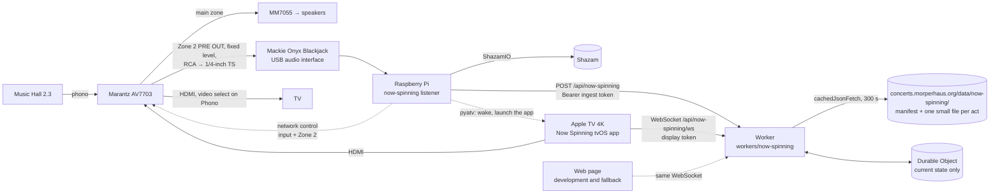
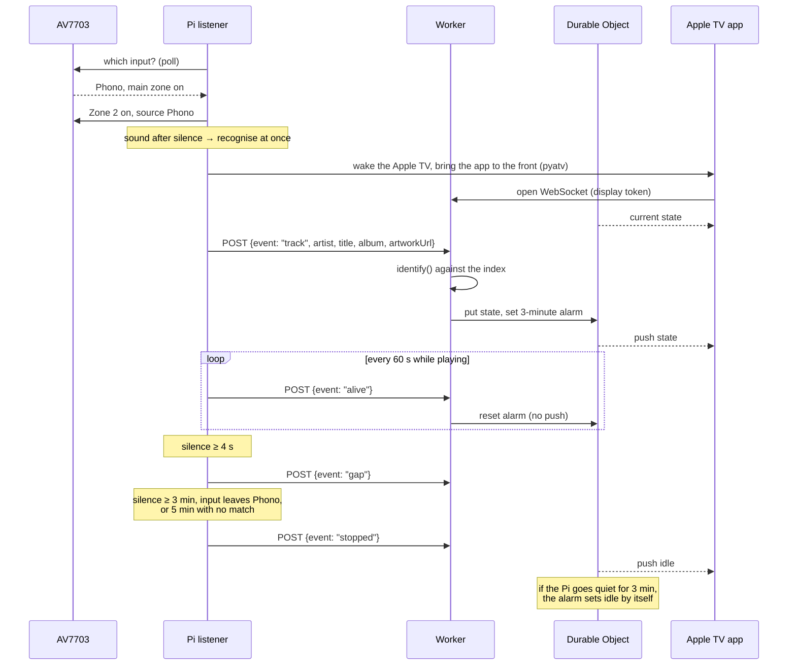

# Now Spinning

**Status:** Planned
**Target Version:** v7.0.0
**Priority:** Medium
**Estimated Complexity:** Very High (hardware, a Python listener, a new Worker with a Durable Object, a display)
**Dependencies:** Bug #689 comes before Phase 1. Phase 0 (a hardware evening, #688) comes before Phase 4. Bug #690 comes before the release.
**Tracking:** epic #687

**Kit in this folder:**
- [`HANDOFF.md`](HANDOFF.md): the original brief and the confirmed AV setup. Where it differs from this spec, the spec wins.
- [`mock/index.html`](mock/index.html): the TV-screen mock, with every screen state. It is the reference for layout and copy. Its matching is a looser stand-in; the real rules are in §Data.
- [`mock/build_mock_data.py`](mock/build_mock_data.py): builds the mock's `data.json`. It's the prototype of the index builder in §Data.
- [`screens/`](screens/): fifteen screenshots covering every screen state (listed under [Screen states](#screen-states))

---

## Executive Summary

When a record plays on the living-room turntable, the TV shows the song, its album, and the
archive's connection to it: the nights Mike heard it live, with his photos from those nights.
Every concert in the archive is a night Mike was there, so this puts that history next to
music he's playing now, without picking up a phone or opening the site.

It is an extension of the archive, not a scene on the website. The pieces are a Raspberry Pi
that listens to the receiver's line-level Zone 2 output, a new Worker on
`concerts.morperhaus.org` that runs the archive lookup and holds the current state, and a
tvOS app on the Apple TV that shows it.

**Decided:**

| Question | Decision |
|---|---|
| Where it lives | Everything (Worker, Pi listener, display, docs) in this repo. Hardware and Xcode tasks are tracked as GitHub issues. |
| Cloud or local | **Cloud.** The Worker plus a Durable Object holds the state. The Pi only captures and identifies. |
| Zone 2 | Free to use. |
| Video routing | Already done: the AV7703 sends the Apple TV picture to the TV while Phono plays. |
| Play history | **None.** No log of vinyl plays is kept anywhere (see [Privacy](#privacy)). |
| Display | **A tvOS app on the Apple TV**, named Morperhaus Now Spinning. The web page is the development display and the fallback. |
| Getting the app onto the Apple TV | One Apple TV, the one in the living room. Installed from Xcode, and reinstalled once a year. Mike has a paid Apple developer account. |
| What v7.0.0 means | A record plays and the tvOS app shows it on the TV: the index, the Worker, the Pi listener and the app, working end to end. |
| Version number | v7.0.0. Social Syndication (#323) moves to v6.5.0. |
| Listener health | Yes. A quiet heartbeat from the Pi, a notice on the idle screen when it's offline, and one line on the operator dashboard. No song data. |
| Audio interface | The Mackie Onyx Blackjack Mike already owns. |
| Cloudflare plan | Free tier. The index is split into small files to stay inside its CPU limit. |
| A record Shazam doesn't know | The screen says "Listening…". |
| "Most played" on the site | Counts songs heard from opening acts too (#690). |

---

## 🚀 Implementation Quick Start

**Copy/paste this prompt when starting a NEW Claude Code session (no prior context):**

```
I need to implement the Now Spinning feature for Morperhaus Concerts.

**IMPORTANT CONTEXT WINDOW MANAGEMENT:**
- This is a fresh session with NO prior context about the project
- You have access to the full codebase and can read any files
- At the end of EACH implementation window, you MUST:
  1. Assess remaining context window capacity
  2. If <30% remains, STOP and ask if I want to continue in a new session
  3. Provide a handoff summary for the next session
- Implement the spec AS WRITTEN - it's the source of truth
- Ask clarifying questions if anything is ambiguous

**Feature Overview:**
- A Raspberry Pi hears the turntable through the AV7703's Zone 2 line output and identifies songs (ShazamIO)
- It POSTs {artist, title, album?, artworkUrl?, isrc?} to a new Worker at concerts.morperhaus.org/api/now-spinning
- The Worker runs the archive lookup (identify(), built on the repo's existing title and act matching utilities) and stores only the current state and the listener's last-seen time in a Durable Object
- A tvOS app on the Apple TV holds a WebSocket to the Worker and renders the state; a web page does the same for development
- No play history is kept, anywhere
- The screen never says something the data can't back up

**Key References:**
- Full Design Spec: docs/specs/future/global-now-spinning/global-now-spinning-spec.md
- Epic and issues: #687 (work the issue for your phase; its checklist is the definition of done)
- Reference layout + copy: docs/specs/future/global-now-spinning/mock/index.html and screens/
- Matching utilities to reuse, not reinvent: scripts/utils/song-title.ts, scripts/utils/act-name.ts
- Worker patterns to copy: workers/mcp-server (wrangler.toml, data.ts cachedJsonFetch, CI workflow with its deploy job)
- Build-time generator precedent: scripts/gen-mcp-landing.ts
- Secrets inventory: docs/SECRETS.md
- PR conventions: .claude/skills/steward/SKILL.md
- Data skill: .claude/skills/data-schema/SKILL.md
- Media rules: .claude/skills/media-pipeline/SKILL.md

**Implementation Approach:**
- Prerequisite: #689 merged before Window 1 (#690 is needed before the release, not before Window 1)
- Phase 0 (Mike, hardware evening, #688): must be done and recorded in this spec before Window 4
- Window 1: match module + index builder + pure identify() with fixture tests
- Window 2: Worker API, Durable Object, auth, liveness, CI + deploy
- Window 3: web display page (the development display)
- Window 4: Pi listener (Python), runnable against a WAV file without hardware
- Window 5: tvOS app: Swift sources and a simulator build check in CI; Mike builds, signs and installs from Xcode

Let's start with Window 1. Should I begin with workers/now-spinning/src/match.ts?
```

---

## Design Philosophy

The record comes first; the archive comments on it. The screen should feel like a sleeve
on a shelf, not a dashboard: one song, one sentence about Mike's history with it, a few
nights, and photos from those nights drifting behind. It has to read from the couch and look
fine left on for an hour.

**The honesty rule.** The screen never states what the data can't back up. In practice:
- "Never heard this one live" appears only when every night Mike saw the act has a setlist
  **and** nobody else played the song at a show he was at.
- A song heard only inside a medley is counted, and the night says "in a medley".
- When a setlist has something close to the song but not the song itself, the screen says that,
  and claims neither "heard" nor "never heard".
- A photo's caption always names the night it is from.
- If the lookup itself fails, the screen shows the song and says nothing about the archive.

---

## Architecture



### Sequence: a record plays



### Why cloud (and what that costs)

The cloud keeps the archive lookup in one place. The Worker reads the same published data the
site does, so it can't drift from the site, and nothing has to be copied to the Pi when the
archive changes. Without the internet the screen stops working, though the record still plays
normally. That trade is acceptable for a display that adds to listening rather than replacing
any part of it.

---

## Phase 0: one hardware evening, before any code

Step-by-step instructions for setting up the Pi and running these checks are in
[`docs/NOW_SPINNING_OPERATIONS.md`](../../../NOW_SPINNING_OPERATIONS.md).

Tracked as #688, which carries these as a checklist.

Four assumptions decide whether this design works, and none can be tested from a desk: Shazam on
real records (check 2), the run-out groove (3), the receiver not switching input when the Apple
TV wakes (4), and the Pi being able to put an app on the Apple TV's screen (5). Test them with
the Pi, the Onyx Blackjack and the Apple TV, and record the results in this spec's revision
history.

| # | Check | Why it matters |
|---|---|---|
| 1 | AV7703: Phono plays out of ZONE2 PRE OUT. Set the Blackjack (see [Audio interface settings](#audio-interface-settings)), then find a fixed Zone 2 level where the loudest record peaks near −12 dBFS and the SIG/OL lights never turn red. | Phono to Zone 2 is confirmed only for the near-identical AV7702 |
| 1b | On the Pi: `arecord -l` lists the Blackjack, and `arecord -D plughw:<card> -f cd -d 10 t.wav` records both channels (`plughw` converts from whatever bit depth the Blackjack offers) | It works without drivers on a Mac, which points to USB Audio Class; this confirms Linux sees it the same way |
| 1c | On the Pi: `vcgencmd get_throttled` reads `0x0`, `/proc/device-tree/chosen/power/max_current` reads 5000 (a recognised 5 A supply), and `dmesg` shows no USB over-current or under-voltage warnings with the Blackjack plugged in. Steps in [`NOW_SPINNING_OPERATIONS.md`](../../../NOW_SPINNING_OPERATIONS.md) §5. | The Blackjack draws its power from the Pi's USB ports |
| 2a | Optional, and possible before the hardware arrives: try the Shazam app on a phone with the same ten records. Note what it calls each artist and title. | Same catalogue as the Pi will query. A match through speakers and room noise is a strong sign; a miss is ambiguous. It doesn't replace check 2. |
| 2 | Run `shazamio` on ten records: an old pressing, a live album, an album with no gaps between tracks, a 45, something obscure. Note the hit rate, the time to first match, and what Shazam calls each artist and title. Save one complete raw response; Phase 4 maps its fields. | The whole feature rests on this. Turntable speed drift and surface noise are the unknowns. |
| 3 | Leave the needle in the run-out groove and watch the level | The Music Hall has no auto-lift, so the click may never read as silence |
| 4 | **Required.** With the receiver on Phono and a record playing, wake the Apple TV. Does the receiver switch input to it? If it does, turn off the Apple TV's "Control TVs and Receivers" (or the receiver's HDMI Control) and try again. | If HDMI Control (CEC) switches the input, waking the Apple TV stops the record. The display depends on this. |
| 5 | **Required.** From the Pi with `pyatv`: pair, read the power state, read which app is in front and whether anything is playing, wake the Apple TV, launch an app, and bring an app back from behind the screensaver. Note which commands worked on tvOS 26, which network the Apple TV is on, and any firewall rule or `--scan-hosts` it needed. | The app can't put itself on screen. The Pi has to, for every record. |
| 6 | Does anything else (Home Assistant, a control app) hold the receiver's telnet port? | These receivers are believed to accept one telnet client at a time |
| 6b | From the Pi: read the main zone's input and power, turn Zone 2 on, set its source to Phono, turn it off. Note the commands that worked and the replies, which network the receiver is on, and any firewall rule it needed. | The listener's gating depends on all four. Nothing else in Phase 0 tests them. |
| 7 | Confirm what `shazamio` sends to Shazam (a fingerprint, or audio). Answered from its source code in Phase 4. | So the privacy section states a fact |
| 8 | As the `now-spinning` user, install `shazamio` with `uv` on Python 3.13. Note the Python version, and whether anything had to be compiled. | The listener pins its Python. If `shazamio-core` has no ready-made build for 3.13 on the Pi, Phase 4 pins a version that has one. |

If check 2 fails, stop and pick another recogniser (ACRCloud, AudD) before going further.
If check 4 or 5 fails with no workaround, the display falls back to the Pi driving the TV
(see [Display](#display)).

---

## Data

### Matching: reuse the archive's rules, add nothing parallel

The repo already has the rules for telling one song or one act from another, written to fail
closed. Now Spinning uses them. It does not define its own.

| Need | Use | Where |
|---|---|---|
| Compare song titles | `foldSongTitle`, `songIndexKeys` | `scripts/utils/song-title.ts` |
| Compare act names | `actKey` | `scripts/utils/act-name.ts` |
| Stored slugs | `normalizeArtistName` | `src/utils/normalize.ts` |
| The archive's album for a song | `songAlbumKey` | `scripts/utils/song-title.ts` |

Those rules strip only version markers ("(Remastered 2006)", "- Single Version"), keep
title-bearing brackets ("(Don't Fear) The Reaper", "[10 Good Reasons for Modern Drugs]"), split
medleys only on a spaced slash, fold accents and unusual hyphens ("Run‐D.M.C."), and read "&" as
"and". Both files are pure, with no imports, and `workers/ask-chat` already imports
`song-title.ts` across packages, so a Worker can use them.

`workers/now-spinning/src/match.ts` is a thin layer on top. It adds only what Shazam's input
needs:
- `cleanArtist`: the fallback that drops `feat. X`, `& Y` or `with Z` from an act name, used only
  when the full name matches nothing.
- `stripFeat` and `tidyTitle`: tidying for display, so "Kool & the Gang" isn't shown as "Kool"
  and "(Remastered 2006)" isn't shown at all.
- `nearKeys`: looser keys (all bracketed text removed; any slash splits; parts of four letters or
  more), used for one purpose only, below.

The Worker and the index builder both import `match.ts`, so the two sides can't disagree.

**Two tiers, and what each may do.**
- **Strict keys** (the repo's rules) decide every positive statement: `heard`, `seen-cover`,
  `cover-of-this`.
- **Near-miss keys** never do. They only stop the screen from saying "never heard this one live"
  when something close is on a setlist, and then the screen says exactly that: *Something close to
  it is on 2 of those setlists: "Smart Patrol/Mr. DNA".*

A prototype of these rules ran against the real archive on 2026-11-21: 2,267 songs, 260 acts, 211
covered acts, no two acts sharing a key, and every input in the [Testing](#testing-strategy)
table resolving as listed.

### A prebuilt index, generated at build time

The lookup needs songs from **every** setlist (openers included), the alias groups, albums,
covers, photos, and which nights have setlists. The raw files add up to about 1.9 MB.

**The index is many small files, not one big one.** The Cloudflare account is on the free tier,
which allows 10 ms of CPU per request. Parsing a single 360 KB index and building its lookup maps
measured about 6 ms in Node on a fast machine, which is too close to rely on. So a lookup reads a
small manifest and then one or two files of a few kilobytes each.

```
public/data/now-spinning/        written by `npm run build`; gitignored, not committed
├── manifest.json                about 15 KB: which acts exist, and the version and rules
├── acts/<slug>.json             one per act (its billings merged), a few KB each
└── covers/<actKey>.json         one per act whose songs someone else played
```

Add `scripts/build-now-spinning-index.ts` and run it in **`npm run build`**, before
`vite build`, next to `gen-mcp-landing.ts`.

Why not `npm run build-data`: the inputs are written by several pipelines. `media-index.json`
comes from `scripts/media/*` (`/media-add`), `album-covers.json` from `resolve-album-covers`,
`artist-aliases.json` from `sync-artist-aliases`. Hooking one of them leaves the index stale
after the others. Generating at build means every deploy publishes an index that matches the
data it ships with, and automated data commits don't churn derived files. Check that the
Cloudflare Pages build command is `npm run build`.

The index reaches production only when the site next deploys after Phase 1 merges. Until then
the Worker answers `unknown` for every song, which is correct but not useful. #693 checks that
`https://concerts.morperhaus.org/data/now-spinning/manifest.json` returns JSON before going on.

The exact shapes live in code, not here: **`workers/now-spinning/src/types.ts`** (`Manifest`,
`ActFile`, `CoversFile`, `NowSpinningState`). In short:
- `manifest.json`: `v`, `generatedAt`, `rules`, `acts` (the `actKey` of every billing name → the
  act's file slug), `covers` (the `actKey`s with a covers file), `ambiguous`, `problems`.
- `acts/<slug>.json`: the act's display `name`, every billing `names`, its `nights` (date, billing,
  venue, city, opener or headliner, whether there's a setlist, up to 3 photos with focal points),
  and its `songs` (the setlist's spelling, strict keys `k`, near-miss keys `nk`, the nights it was
  played `on`, and its album).
- `covers/<actKey>.json`: `rows`, each a song by that act someone else played at a show Mike was
  at: the song, its keys, the performer, the night and its photos.

- **The manifest is the authority on what exists.** A missing file on this site comes back as the
  site's HTML with status 200, so "no such file" can't be told from "not in the archive" by
  fetching. The manifest settles it: an act that isn't in `acts` has not been seen; an act that
  is listed but whose file won't load is "index unavailable".
- **A lookup reads at most three files:** the manifest (kept in memory, refreshed every 300
  seconds), the act's file if the act is listed, and its covers file if one is listed. Cover rows
  carry the venue and photos themselves, so no further file is needed.
- File names are slugs and `actKey`s, which are lowercase letters, digits and hyphens only.

Builder rules:
- Songs come from `setlists-cache.json`. Skip `tape` entries.
- Merge `sameAct` billings; keep `sharesMember` acts separate. (They are joined at lookup time, by the cover data. See below.)
- **The builder never fails the site's build.** It runs inside `npm run build`, so an exception
  here would stop the whole site from deploying, and the data changes by itself every day. When
  it meets data it can't use, it leaves that item out and records it in `problems`:
  - A song with no strict key (a title that folds to nothing) is left out.
  - Two different acts sharing an `actKey` are both listed in `ambiguous`. The lookup answers
    `unknown` for that key and never guesses between them.
  - On 2026-11-21 no acts collide, and three setlist entries have no key ("With Any Sort of
    Certainty"), which is bug #689.
  The real-data test (below) is what turns a problem red, in CI and on the daily scheduled run.
- **Version.** The Worker accepts a manifest with `v: 1` only. Any other value, or a file that
  isn't JSON, counts as "index unavailable".
- **Rules fingerprint.** The site and the Worker deploy separately, and both contain the matching
  rules: the builder uses them when the site builds, the Worker when a song arrives. If one side
  deploys a rule change before the other, their keys stop agreeing and real matches are missed.
  So the manifest carries `rules`, a short hash of the rules applied to a fixed list of sample
  titles and names. The Worker computes the same hash from its own copy. A mismatch counts as
  "index unavailable" until both sides are deployed.
- Album covers: `album-covers.json` mzstatic `100x100bb` → `600x600bb`. Fall back to
  Cover Art Archive `front-500` when `coverAvailable`.
- Photos: `media-index.json` assets with `subject: 'artist'` and `kind: 'image'`, keyed
  `date|artistNormalized`, up to 3 per night, `hero` frames first and then by `order`. Carry the
  centre of each asset's `crop` so the display can keep the subject in frame. Use the site URLs
  as they are. Videos (22, hosted on `media.morperhaus.org`) are left out of v1.
  Follow `.claude/skills/media-pipeline/SKILL.md`: only published assets, no new derivatives,
  and the photo's own act and date always travel with it.

### Two existing bugs this work depends on

Both predate this work.

- **#689, before Phase 1: `foldSongTitle` treats "with" in a title as a featured artist.**
  "Dancing With Myself" folds to `dancing`, and "With or Without You" to nothing. Now Spinning's
  strict matching is this function, so two different songs by one act could count as the same
  song. Fixing it changes keys in `song-albums.json`, and the ask-chat and MCP Workers bundle the
  same function, so they must be redeployed with the regenerated data (the issue says how).
- **#690, before the release: `song-index.json` ignores opening acts' setlists** (1,720 songs
  against 2,267 from all setlists). The site and Ask the Archive read it, so they don't know
  Blancmange played "Blind Vision" as an opener. Phase 1 doesn't read that file, so it isn't
  blocked. But if the TV counts every setlist and the site doesn't, the same song gets two
  different numbers, so it has to land before v7.0.0 ships.

### Lookup (`workers/now-spinning/src/identify.ts`)

A pure function, `identify(index, input) → Track`. The mock's `identify()` and `render()` show its
shape and all its copy; the matching follows the rules above.

1. **Act.** `actKey` of the name exactly as Shazam gives it. Only if that matches nothing,
   `actKey(cleanArtist(name))`. So "Echo & the Bunnymen" matches "Echo and the Bunnymen", and
   "Depeche Mode feat. X" still finds Depeche Mode.
2. **Title.** Shazam's title is compared whole: `foldSongTitle(title)`. A setlist entry answers to
   the fold of its whole name and to each part `songIndexKeys` gives. So "Head Over Heels /
   Broken" answers to "Head Over Heels", and that night is flagged `medley`. "Smart Patrol/Mr.
   DNA" has no spaced slash, so it answers only as a whole, which is how Shazam names that track.
3. **Billings.** Collect every billing of the canonical act (Brian Setzer has four).
4. **Other hands, always.** Look up who else played this act's songs **whether or not Mike
   has seen the act**, under every name the act goes by, full name first. Setlist.fm's `cover`
   field is what joins the `sharesMember` pairs: George Michael playing Wham!, Danny Elfman
   playing Oingo Boingo, Marc Almond playing Soft Cell. 38 setlist entries are songs by an act
   Mike has seen that he only ever heard from someone else.
5. **Near miss.** If the act has been seen and no strict key matches, try the near-miss keys. A
   hit changes the wording of the `seen` screen and nothing else.
6. **Album.** The archive's album when it has one (`songAlbumKey`); otherwise the album and
   artwork Shazam sent.
7. **Displayed names.** The archive's spelling when the whole title matched. Otherwise Shazam's
   title with only its noise removed (`tidyTitle`) and Shazam's act with only `feat. X` removed
   (`stripFeat`).

### Screen states

Checked in this order. Headlines are the mock's; all were run against the real archive.

| # | `screen` | When | Headline | Photos from |
|---|---|---|---|---|
| 1 | `heard` | The act played it on a night Mike was there | "You've heard this one live N times." If someone else also played it, add "Y played it too." | the nights it was heard |
| 2 | `seen-cover` | Act seen, never heard from them, but someone else played it | "You've seen Wham! once, and you heard George Michael play this one." Second line says what the act's own setlists show. | the nights the other act played it |
| 3 | `seen` | Act seen, song not found anywhere | Three wordings. Near miss: "Something close to it is on the setlist from …". Every night has a setlist and no near miss: "…but never heard this one live." Otherwise: the "maybe" copy about missing setlists. | every night the act was seen |
| 4 | `cover-of-this` | Act never seen, someone else played this song | "You've never seen X. But you've heard this one live, played by Y." | those nights |
| 5 | `covers` | Act never seen, others played other songs of theirs | "…you've heard N of their songs live, in other hands." | those nights |
| 6 | `none` | No connection | "Not in the archive. Yet." | none (the screen takes its colour from the record) |
| 7 | `unknown` | The index couldn't be loaded | Song, artist and Shazam's album only. No archive line. | none |

For an act Mike has seen, covers of the act's *other* songs aren't shown. The act's own nights
are the better story there.

States that aren't songs:

| `kind` | When | Screen |
|---|---|---|
| `idle` | Nothing playing (the default) | Brand mark, dimmed, and a small "Put a record on." line. No clock or other data. If the listener is offline or can't identify songs, one line under it says so (`notice`). It doesn't stay up: the app hands over to the Apple TV's screensaver, and the web page goes black after 10 minutes (see [Screen care](#screen-care-the-tv-is-an-oled)). |
| `gap` | Between tracks or while flipping sides | Keep the last track's screen. After 90 s, fade the text and keep the sleeve and spinning record. |
| `unmatched` | Sound present, no match after 3 tries | "Listening…" with the generic sleeve, and "Nothing I recognise yet." Never guess. |

Copy follows `.claude/skills/liner-notes-voice/SKILL.md`: "you" addresses Mike, plainly, with
no hype.

**Reference screenshots.** Every state has one in [`screens/`](screens/), and the mock's
"Change record" panel shows each live.

| State | Screenshot |
|---|---|
| `heard` | `heard-live.jpg`, `heard-live-mirrored.jpg` (the mirrored layout), `heard-once-opener.jpg`, `heard-in-medley.jpg` |
| `seen-cover` | `seen-heard-from-another.jpg` |
| `seen` | `seen-not-heard.jpg`, `seen-near-miss.jpg` |
| `cover-of-this` | `no-history-song-covered.jpg` |
| `covers` | `no-history-artist-covered.jpg` |
| `none` | `no-history-none.jpg` |
| `unknown` | `unknown.jpg` |
| `idle` | `idle.jpg`, `idle-listener-offline.jpg` |
| `gap`, after 90 s | `gap-faded.jpg` |
| `unmatched` | `unmatched.jpg` |

---

## Worker API (`workers/now-spinning`)

New self-contained Worker, matching `workers/mcp-server`: its own `package.json`, `vitest.config.ts`,
`wrangler.toml`, and a path-filtered CI workflow `.github/workflows/now-spinning-ci.yml`.

- Route: `concerts.morperhaus.org/api/now-spinning*`. It's more specific than meta-injector's `/*`, like `/api/ask*`.
- `[vars] DATA_BASE_URL = "https://concerts.morperhaus.org/data"`. Load the manifest and the
  files a lookup needs with `cachedJsonFetch` (300 s TTL), so the screen reflects a site deploy
  within about 5 minutes.
- One SQLite-backed Durable Object class `NowSpinningRoom`, one instance (`idFromName("living-room")`).

| Method + path | Auth | Body / response |
|---|---|---|
| `POST /api/now-spinning` | ingest token | `{ event: "track", artist, title, album?, artworkUrl?, isrc?, shazamId? }`, or `{ event: "gap" \| "unmatched" \| "stopped" \| "alive" }`, or `{ event: "status", recognizer, receiver, appleTv, version }`. Body ≤ 2 KB. Returns the new state. `400` on a bad body. |
| `GET /api/now-spinning` | display token | Current state (polling fallback, debugging) |
| `GET /api/now-spinning/ws` | display token | WebSocket. Sends the current state on connect, then each change. Answers the text `ping` with `pong` (the heartbeat). Uses DO WebSocket hibernation, so an idle evening costs nothing. |
| `GET /api/now-spinning/health` | display token | `{ online, lastSeenAt, recognizer, receiver, appleTv, version }`. No song data. |

### The state contract

```ts
interface NowSpinningState {
  v: 1;
  kind: 'idle' | 'unmatched' | 'track' | 'gap';
  at: string;          // when this state began (server clock)
  now: string;         // server clock when this message was sent
  notice?: string;     // idle only: one line the Worker writes when the listener is offline or can't identify
  track?: {
    title: string; artist: string;
    album: { title: string; year?: string; coverUrl?: string } | null;
    screen: 'heard' | 'seen-cover' | 'seen' | 'cover-of-this' | 'covers' | 'none' | 'unknown';
    count?: { n: number; times: boolean };   // the big numeral; times → draw the "×"
    headline: string;
    lines: string[];                         // 0–2 supporting lines, already written
    nights: { date: string; dateLabel: string; text: string; hasPhotos: boolean }[]; // max 4, newest first
                                             // hasPhotos is sent but no display draws it (2026-11-24)
    moreNights: number;
    photos: { url: string; caption: string; fx: number; fy: number }[]; // absolute URLs, max 5
    accentHue: number;                       // hue() from the mock, for the generated sleeve and glow
  };
}
```

- **The Worker writes every word and formats every date.** Displays only lay out. A copy change
  then ships with a Worker deploy and reaches every display at once.
- **Forward compatibility.** A display that meets a `screen` it doesn't know renders it as
  `unknown` (song only). An unknown `kind` renders as `idle`. Displays ignore fields they don't
  know. This matters because a tvOS app updates far less often than the Worker.
- **One set of fixtures is the contract:** `test/fixtures/now-spinning-states.json`, one state
  per `screen` and `kind`. The Worker's tests produce them, the web page can render any of them
  with `?fixture=heard` (the site build copies the file to `/data/now-spinning/states.json`), and
  Swift previews load the same file. Same idea as
  `test/fixtures/deep-link-urls.json`.

### Behaviour

- **Two values, overwritten.** Durable Object storage holds the current state and the listener's
  status (below), and nothing else. No history, no list, no Analytics Engine rows naming songs.
  Log the state `kind` only.
- **Logic apart from the runtime.** The rules in this section live in a pure module
  (`room-logic.ts`: state, event and clock in; new state and next alarm time out). The Durable
  Object class is a thin shell around it. The repo's Workers are tested with plain vitest, with
  no Workers runtime, so this is what makes the alarm and dedupe rules testable.
- **Liveness.** Every ingest POST sets a DO alarm three minutes out. If the alarm fires, the
  state becomes `idle`. A Pi that loses power or network can't leave a song on the screen all
  night.
- **Same track again.** While `kind` is `track`, a `track` event for the same song (same
  `shazamId`, or same artist and title) resets the alarm and pushes nothing. From `gap`,
  `unmatched` or `idle`, it sets `track` and pushes, so replaying a song works.
- **Timers belong to the display.** The 90 s gap fade starts when the display receives `gap`.
  After a reconnect it uses `now − at` from the message, never its own clock.
- **Index unavailable.** A `track` event still produces a state, with `screen: 'unknown'`. It
  must never fall through to `none`, which would be a false statement. Retry the index on the
  next event. "Unavailable" covers a failed fetch, a file that isn't JSON, a version other than
  1, a rules fingerprint that doesn't match, and a file the manifest lists that won't load.
- **Where the lookup runs.** In the Worker, before the Durable Object is called. The manifest is
  kept in module scope for the life of the isolate and refreshed when the 300-second cache turns
  over. Act and covers files are fetched per song, through the same cache.
- **CPU budget.** The account is on the free tier: 10 ms of CPU per request. That is why the index
  is split into small files. Phase 2 still measures a cold request with `wrangler tail` and
  records the figure; the target is under 3 ms.
- **No caching of answers.** Every response carries `Cache-Control: no-store`.
- **Heartbeat.** A home network can drop an idle connection without either end noticing. The
  display would then keep showing an old song, and on the TV it would keep the screen awake doing
  it.
  - Each display sends the text `ping` every 30 s.
  - The Durable Object answers `pong` through `setWebSocketAutoResponse`, so the runtime replies
    without waking it, and an idle evening still costs nothing.
  - A display that sent a ping and has heard no pong by its next one treats the socket as dead.
    It closes it, polls, and reconnects. So a dead socket is noticed within a minute.

### Listener health

Without this, a dead Pi or a blocked recogniser looks exactly like "nothing playing".

- The Pi POSTs `{ event: "status", recognizer: "ok" | "failing", receiver: "ok" | "unreachable",
  appleTv: "ok" | "unreachable", version }` every 5 minutes, playing or not.
- The Durable Object keeps `listener: { lastSeenAt, recognizer, receiver, appleTv, version }` beside the
  state. Every ingest POST refreshes `lastSeenAt`. It holds no song data.
- `GET /api/now-spinning/health` returns it, plus `online` (seen in the last 15 minutes).
- **On the idle screen.** When the listener is offline or the recogniser is failing, the Worker
  sets `notice` on the idle state: "The listener has been offline since 3:12 PM." or "Song
  recognition isn't working right now." Times use `DISPLAY_TZ`, a Worker var set to the home's
  time zone. Displays show `notice` under "Put a record on." and nowhere else.
- **The time carries its date once the day changes.** A bare "since 3:12 PM" reads as today, so
  from the next midnight in `DISPLAY_TZ` the notice says "since Nov 23, 3:12 PM". This is the
  [honesty rule](#design-philosophy) applied to the notice.
- **One alarm, three deadlines.** A Durable Object has a single alarm. Keep all three deadlines
  and set the alarm to the earliest one:
  - liveness: 3 minutes after the last ingest while not idle
  - offline: 15 minutes after `lastSeenAt`
  - the date: the next midnight in `DISPLAY_TZ`, while the room is idle and the listener is
    offline. It rewrites the notice and pushes it; after that it fires once a day and changes
    nothing. The midnight is worked out from the clock each time, so it needs no storage key.
- **Operator dashboard.** `workers/dashboard-refresh` reads `/health` and shows one line: online,
  or last seen. That work is in the release issue, #699.

### Auth and secrets

| Secret | Homes |
|---|---|
| `NOW_SPINNING_INGEST_TOKEN` | prod `wrangler secret`, `workers/now-spinning/.dev.vars`, Pi `/etc/now-spinning/env` |
| `NOW_SPINNING_DISPLAY_TOKEN` | prod `wrangler secret`, `.dev.vars`, each browser that opens the web page, `Secrets.xcconfig` on Mike's Mac (it is built into the app), and `workers/dashboard-refresh` (to read `/health`) |

Add both to `docs/SECRETS.md`'s matrix. Generate each with `openssl rand -hex 32`; they must
differ. Hex on purpose: the web page sends its token as a WebSocket subprotocol, which may not
contain the `/` or `=` that base64 produces. Rotating the display token signs every display out until it is given the new one.

- Two tokens, so a display can't write and a leaked Pi token can't read. The display token
  exists because the current state says what's playing in the house, and that someone is home.
- `POST` and `GET` take `Authorization: Bearer`. A native WebSocket client sends the same header
  on the upgrade request. A browser can't set headers on a WebSocket, so the web page sends
  `Sec-WebSocket-Protocol: now-spinning.v1, <token>` and the Worker answers with
  `now-spinning.v1` only. **No tokens in query strings**, which end up in logs.
- Compare tokens in constant time.
- **Fail closed.** If either secret is missing or empty, every request gets `503`. This is what
  makes the first deploy safe (below).

### Deploy

Workers in this repo deploy from CI on a push to `main`: copy the `deploy` job from
`mcp-ci.yml`. So merging Phase 2 puts a public endpoint live. First-deploy order: merge, let CI
deploy (the Worker answers `503` to everything), set both secrets with `wrangler secret put`,
then check `GET` returns `idle`. Those owner steps are #693. Add `workers/now-spinning` to
`npm run test:workers` and to `.github/dependabot.yml`.

**What redeploys the Worker.** Its CI path filter must include the shared code it bundles, as
well as `workers/now-spinning/**`. It bundles `scripts/utils/song-title.ts` and
`scripts/utils/act-name.ts` and nothing from `src/utils/`, so the filter watches
`scripts/utils/**`: a folder, not a list of files, so a newly imported file can't be missed. #689
moved the other Workers' filters to folders for the same reason. The rules fingerprint is the
safety net for when the site's deploy and the Worker's land at different times.

**Local development.** Run the Worker with `wrangler dev` and add a Vite proxy from
`/api/now-spinning` to it, so the display page and the Worker are same-origin locally as they are
in production. No CORS headers are needed anywhere.

---

## Pi listener (`now-spinning/pi/`)

A Python service, installed with `uv` from a committed lockfile on **a pinned Python**: 3.13, the
version the Pi's UniFi servers already use. Phase 0 check 8 confirms `shazamio-core` has a
ready-made build for it on the Pi; if it doesn't, pin the newest version that has one.
`requires-python` and CI follow the pin. Run by systemd (`now-spinning.service`, restart on
failure). `sounddevice` needs the `libportaudio2` system package.

Config is in `/etc/now-spinning/env`: the Worker URL, the ingest token, the receiver's address,
the Apple TV's identifier and address, and the audio device. The file is readable by root only;
systemd reads it (`EnvironmentFile=`) before it starts the service as its own user.

**A shared Pi.** The Pi also runs the UniFi MCP servers, set up from their own runbook ("UniFi MCP
on Raspberry Pi — Setup Guide", in the Unifi Administration project). They keep a view-only
console password under `/home/unifi-mcp`. That password can sign in to the console directly and
see the network and the cameras, so nothing of Now Spinning's may be able to read it:
- **Its own user.** The listener runs as the system user `now-spinning`: no login shell, no
  `sudo`, in the `audio` group, with its home at `/var/lib/now-spinning`.
- **A sandboxed service.** `now-spinning.service` sets `User=now-spinning`, `NoNewPrivileges=yes`,
  `ProtectSystem=strict`, `ProtectHome=yes` (the service sees no `/home` at all), `PrivateTmp=yes`,
  `UMask=0077`, and `StateDirectory=now-spinning` with `StateDirectoryMode=0700`.
- **Code it can't change.** The code, its Python environment and the interpreter itself live in
  `/opt/now-spinning`, owned by root (`UV_PYTHON_INSTALL_DIR` under `/opt/now-spinning`, or the
  system's Python). `uv` is a root-owned copy at a pinned version, in `/usr/local/bin`. The service
  can read and run all of it, not write any of it.
- **Its home holds data only.** `/var/lib/now-spinning` is the one place the service can write. It
  holds the Apple TV pairing and nothing that is ever executed: **root never runs anything from
  it.** A virtual environment's `python` is a link to its base interpreter, so an interpreter
  kept there could be swapped by a compromised listener and then run by root at the next update.
  The copy of `uv` that Phase 0 puts there is for testing, and is deleted afterwards.
- **No third-party code as `pi` or root.** That covers `shazamio`, `pyatv` and the listener, in
  Phase 0 as well as in service. The one exception is the installer: root runs its own pinned
  `uv`, and installing must not build or run package code (`uv sync --frozen --no-build`).
- **No open port.** The listener only makes outbound connections: to Shazam, the Worker, the
  receiver and the Apple TV.
- **The operating system belongs to the UniFi runbook.** Never reflash the card for Now Spinning.
- **Other networks.** If the receiver or the Apple TV is on a different VLAN from the Pi, the
  firewall has to let the Pi reach it, and `pyatv` is given the Apple TV's address, because
  device discovery doesn't cross VLANs. Phase 0 checks 5 and 6b record what was needed.

**Gating on the receiver.**
- Listen only while the main zone is on and its input is Phono. Then turn Zone 2 on with source
  Phono. When the input leaves Phono or the main zone turns off: POST `stopped`, stop
  listening, and turn Zone 2 off if the listener turned it on.
- The listener never touches the main zone.
- Prefer the receiver's HTTP control (what the `denonavr` library uses) and poll every 5 s.
  Don't hold the telnet port open unless Phase 0 check 6 shows nothing else needs it. Use the
  commands Phase 0 check 6b found to work.
- **Receiver unreachable.** After three failed polls, stop gating and listen on sound alone. If
  Zone 2 is off there is only silence, so nothing is posted. Report `receiver: "unreachable"`
  in the status heartbeat and keep polling.

**Putting the app on the screen.** A tvOS app can't bring itself to the front, so the listener
does it with `pyatv`, using the commands Phase 0 check 5 found to work.
- Paired with the Apple TV once, as the `now-spinning` user; the credentials live in its home,
  `/var/lib/now-spinning`, readable by that user only.
- **When:** each time the listener hears sound after silence while the receiver is on Phono,
  before the song is identified. Not only when the input switches to Phono. This is what makes a
  second record an hour later appear instead of playing behind the screensaver, and it means
  "Listening…" is visible for a record Shazam doesn't know.
- **What:** wake the Apple TV if it's asleep, then bring the app to the front if it isn't there,
  including from behind the screensaver.
- **Never interrupt.** If the Apple TV reports that something is playing, do nothing. A paused
  app is not protected: it goes to the background and keeps its place.
- When the record stops, do nothing. The app goes idle and the Apple TV's screensaver takes over.
- If the Apple TV can't be reached, keep listening and posting. Report `appleTv: "unreachable"`
  in the status heartbeat.

**Identification loop.**
- Capture 44.1 kHz stereo from the Blackjack (`sounddevice`, selected by name, not by card
  number, which can change between boots), downmixed to mono.
- **First match fast.** When sound follows silence, record a 10 s clip and recognise at once.
  Target: the screen changes within about 30 s of the needle landing.
- **Then slow down.** Once a track is established, check every 30 s, and immediately after any
  gap. That keeps calls to Shazam near two a minute.
- **No flapping.** Replacing an established track needs two results in a row that agree. The
  first result after a gap, `unmatched` or idle posts straight away.
- **Silence.** RMS below −50 dBFS for ≥ 4 s → POST `gap` once; for ≥ 3 min → `stopped`. Tune the
  threshold in Phase 0 against real surface noise.
- **No match.** Three misses in a row → POST `unmatched` once. Five minutes of sound with no
  match (the run-out groove, a record Shazam doesn't know) → POST `stopped` and try once every
  two minutes until something matches or real silence resets the loop.
- **Heartbeats.** POST `alive` every 60 s while there is a track, a gap or `unmatched`. POST
  `status` every 5 minutes always (see [Listener health](#listener-health)); `recognizer` is
  `failing` when the last three recognition calls raised errors, as opposed to finding no match.
- Clips stay in memory and are never written to disk.
- Network failures: retry with backoff. The listener never crashes because the Worker is down.

**What the listener sends.** To be confirmed against the raw response saved in Phase 0 check 2:

| Field | From Shazam's response |
|---|---|
| `artist` | `track.subtitle` |
| `title` | `track.title` |
| `album` | the `text` of the `track.sections[].metadata` entry titled "Album" |
| `artworkUrl` | `track.images.coverart` |
| `isrc` | `track.isrc` |
| `shazamId` | `track.key` |

**Testing without hardware.** `python -m now_spinning --wav sample.wav --dry-run` runs the
loop on a file and prints what it would POST. Unit-test the silence gate, the two-in-a-row
rule, the run-out timeout and the gating state machine with synthetic audio and a fake receiver.
CI: `.github/workflows/now-spinning-pi-ci.yml` (pytest, on the lockfile), plus a `uv` entry in
dependabot.

**ShazamIO risk.** ShazamIO is an unofficial client for Shazam's private API. It can break or be
blocked without notice. Keep recognition behind one `Recognizer` interface so ACRCloud or AudD,
which are paid but official, can replace it with a config change. Phase 0 check 8 shows whether
`shazamio-core` installs on the pinned Python without compiling.

**Running it.** Power the Pi from an outlet that stays on, because cutting power while it is
writing can corrupt the card. The system log stays on the card with a size cap
(`Storage=persistent`, `SystemMaxUse=64M`): the Pi holds credentials, so the record of SSH
logins has to survive a reboot.

**Updating is done on purpose,** as for the UniFi servers: pull the new code into
`/opt/now-spinning`, rebuild the environment from the lockfile, restart the service. Nothing
updates itself. Phase 4 adds the install, update and token-rotation steps to
`docs/NOW_SPINNING_OPERATIONS.md`, which already covers preparing the Pi.

---

## Display

The picture on the TV comes from a **tvOS app** on the Apple TV, which is already what the TV
shows while Phono plays. A **web page** renders the same state and is built first: it is how the
Worker and the copy get developed without a build-and-install cycle, it is the reference the app
is checked against, and it is the fallback.

### Web page: the development display (`public/now-spinning.html`)

The mock is already most of a display. Phase 3 turns it into one: a static page that opens the
WebSocket and renders the state instead of running its own lookup. It also puts the screen on a
laptop, a phone or an iPad.

- Layout, fonts, colours and motion are the mock's: sleeve and spinning record on the left,
  text column on the right, photo strip bottom-left, brand bottom-right, on a 1920×1080 stage
  scaled to fit. Colours match the site's dark scenes (`.claude/skills/design-system/SKILL.md`).
- Motion: record at 33⅓ rpm (1.8 s a turn), slide-out and back on a new track (0.9 s), text
  fade-up (0.9 s), background photos crossfade every 7 s. Honour `prefers-reduced-motion`.
- Photos use `fx`/`fy` as the focal point (`object-position`), so the crop Mike chose survives.
- Address: `https://concerts.morperhaus.org/now-spinning`. Cloudflare Pages serves
  `public/now-spinning.html` without the extension, as it does `/about-mcp`.
- Token: open the page once as `…/now-spinning#token=…`. The page stores it in
  `localStorage` and clears the fragment. A fragment never reaches the server.
- Without a valid token the page shows the idle screen and nothing else.
- `<meta name="robots" content="noindex">`. Don't add it to `scripts/generate-sitemap.ts`, which
  lists pages by hand. Add its path to the static-page exemption in
  `workers/meta-injector/worker.js` (`/now-spinning`, next to `/about-mcp`), so bots get the page
  as written.
- If the socket drops: reconnect with backoff, and poll `GET` every 10 s meanwhile.
- Send the heartbeat (`ping` every 30 s, see [Behaviour](#behaviour)), and treat a missing `pong` as a dropped socket.
- Idle: the brand mark stays where it is, as in the app. The TV's Pixel Shift moves the whole
  panel, and the page goes black after 10 minutes (see [Screen care](#screen-care-the-tv-is-an-oled)).

### Diagnostics panel: telling where a problem is

The page and the tvOS app read the same state from the same Worker. So the page is the way to
tell problems apart: if the page is right and the TV is wrong, the fault is in the app or the
Apple TV, not in the Pi or the Worker.

Adding `#debug` to the page's address opens a small panel over one corner. It is off unless
asked for, and it shows only the present moment:

| Shows | From |
|---|---|
| Connection: live, reconnecting or polling, and how long ago the last message arrived | the page itself |
| The contract version and the raw state exactly as the Worker sent it | the WebSocket |
| Listener: online or last seen, song recognition, receiver, Apple TV, listener version | `GET /api/now-spinning/health`, refreshed every 30 s |
| Which fixture is loaded, when `?fixture=` is in use | the page itself |

- It uses the display token the page already holds. It adds no endpoint and stores nothing.
- It keeps no list of past songs, in line with [Privacy](#privacy).
- The tvOS app has no such panel. Checking the TV against this page is the diagnostic.
- `docs/NOW_SPINNING_OPERATIONS.md` has the table that turns what the page and the TV show into
  where to look.

### Screen care: the TV is an OLED

The TV is a Samsung S95C (QD-OLED, model QN65S95CAFXZA). Burn-in on an OLED is uneven wear: bright
things that sit in one place for hundreds of hours age those pixels faster. One double album
does nothing. The same layout in the same place for every listening session over years could.
The design is already mostly dark, with changing photos and text. These rules cover what isn't:

| Rule | How | Why |
|---|---|---|
| **Cap the sleeve's brightness** (required) | Album art and the generated sleeve render at about 82% (`filter: brightness(.82)` on the page; the same in the app) | Wear rises steeply with brightness, this panel is very bright, and the sleeve is the largest bright area that stays put for a whole album |
| **Nothing static when idle** (required) | tvOS app: clear `isIdleTimerDisabled` on `idle`, so the Apple TV's screensaver takes over. Web page: after 10 minutes of `idle`, fade to solid black with nothing drawn; any non-idle state brings it back. | An idle screen left up for hours is the longest-lived static image there is. Black OLED pixels are off. |
| **Mirror the layout for each record** (should) | The first track after `idle` flips the layout: sleeve left and text right, then sleeve right and text left. The choice is remembered (`localStorage` on the page, `UserDefaults` in the app) so a restart doesn't reset it. | Spreads what wear there is across both halves of the screen |

- **A `notice` on the web page is the one exception to going black.** "The listener has been
  offline since…" stays up, dim, and moves to a new position each minute. In the app, the notice
  shows on the idle screen until the screensaver starts, and again whenever the app is opened.
- **No drift in the app or the page.** The layout and the brand mark stay put; the TV's own Pixel
  Shift moves the whole panel, so keep it on. The one thing that moves is the notice on the
  page's black screen (above), because it is the only thing drawn there.
- The web page's timer is its own. The 10 minutes count from `at` on the idle state, using
  `now − at`.
- The mock shows all three: "Next record (mirrored)" and "Idle for 10 minutes (black)" in its
  panel, and the brightness cap is always on. Reference: `screens/heard-live-mirrored.jpg`.

**Settings, once (owner):**
- TV: Settings → General & Privacy → Panel Care: **Pixel Shift on**, **Adjust Logo Brightness on**.
- The app's picture arrives on the Apple TV's input, which is also the film input, so leave that
  input's picture mode as it is. The app keeps itself dim instead (the brightness cap).
- Apple TV: Settings → Video and Audio → Match Content → **Match Dynamic Range**. With it on, the
  app (standard range) isn't stretched into HDR brightness. It changes how everything on the
  Apple TV is shown, so it's Mike's call.
- Apple TV: a short screensaver delay (Settings → Screen Saver → Start After), so an idle screen
  doesn't sit for long.

### On the TV: the tvOS app (`now-spinning/tvos/`)

Decided 2026-11-21. The app is named **Morperhaus Now Spinning** (its display name on the Apple
TV's home screen). SwiftUI, tvOS 26, bundle `org.morperhaus.nowspinning`.

**The app**
- Renders the same state contract as the web page, with the same layout, fonts (Playfair Display
  and Source Sans 3, bundled with their Open Font License files), copy and motion. It writes no
  words of its own.
- `URLSessionWebSocketTask` with the `Authorization` header. Reconnect with backoff, poll `GET`
  every 10 s while the socket is down, and reconnect whenever the app returns to the front.
- The same heartbeat as the page: `ping` every 30 s; no `pong` by the next one means the socket
  is dead. This matters most here, because a track keeps the Apple TV awake.
- An unknown `screen` renders as `unknown`; an unknown `kind` renders as `idle`. The app is
  updated far less often than the Worker, so this rule matters most here.
- SwiftUI previews load `test/fixtures/now-spinning-states.json`, one per state, so each can be
  compared with its screenshot in `screens/` without a record playing.
- The display token comes from an untracked `Secrets.xcconfig`, not an entry screen, since this
  is a single personal build.
- `isIdleTimerDisabled` is set while `kind` is `track`, `gap` or `unmatched`, and cleared on
  `idle`, so the Apple TV's own screensaver takes over when nothing is playing.
- The Menu button exits. Nothing else is interactive.
- Reduce Motion in tvOS turns the motion off.

**App icon.** The same network mark the site and its social accounts use. It is not redrawn.
- **Source:** the layers the project already keeps in `docs/design/icons/MorperhausConcerts.icon/`
  (`connections.svg`, `nodes.svg`, `hero.png`) and that file's base gradient, `#1e1b4b → #581c87`.
- **What tvOS changes:** its icons are wide (5:3) and layered, so the layers shift against each
  other when the icon is focused. **Back to front: the gradient across the whole canvas, then
  the connecting lines, then the outer nodes, then the hero node.** The lines sit under every
  node, as in the original drawing. The mark sits centred with a clear
  margin, because a focused icon is enlarged and its edges are cropped.
- **Generated, not exported by hand:** extend `scripts/generate-brand-assets.ts`
  (`npm run generate:brand`), which already follows a one-source rule for the mark. It writes each
  layer at 400×240 and 800×480 into the app's asset catalog.
- As far as is known, Icon Composer's `.icon` file can't be used directly for a tvOS target. Check
  when the project is created; if Xcode accepts it, use it and skip the generated layers.
- Preview of the composition: [`tvos-icon-preview.png`](tvos-icon-preview.png).

**What a Code session can and can't do.** It can write the Swift sources and the Xcode project.
It can't build, sign or run them. Two things narrow that gap:
- A CI job on a macOS runner builds the app for the tvOS Simulator without signing
  (`.github/workflows/now-spinning-tvos-ci.yml`), so every PR proves the code compiles. It runs
  only when `now-spinning/tvos/**` changes. macOS runners are free for a public repository and
  billed at a higher rate for a private one.
- The fixture previews let Mike check every screen in Xcode in a minute.

**The Xcode project is generated, not written by hand.** A Code session can't open Xcode, and a
hand-written project file is easy to get subtly wrong. So the repo holds a short `project.yml`,
and XcodeGen turns it into the Xcode project: in CI before the build, and on Mike's Mac with
`brew install xcodegen` and then `xcodegen` in `now-spinning/tvos/`. The generated
`.xcodeproj` is gitignored.

**Putting it on the screen** is the listener's job: see
[Pi listener](#pi-listener-now-spinningpi). It depends on Phase 0 checks 4 and 5.

**Getting it onto the Apple TV, and keeping it there.** One Apple TV, the one in the living
room. Mike has a paid Apple Developer Program membership.

- **Install from Xcode.** Pair the Apple TV once (Apple TV: Settings → Remotes and Devices →
  Remote App and Devices; Xcode: Window → Devices and Simulators), choose it as the run
  destination, and Run. The app stays installed after Xcode disconnects.
- **Reinstall once a year.** An app installed this way works until its signing expires, about a
  year later. Then it won't open until it is run from Xcode again, which takes a few minutes.
  A calendar reminder a few weeks ahead is the whole mechanism.
- The Worker writes the copy, so wording changes never need a reinstall. Only a change to the
  app's own code does.
- If the yearly reinstall ever becomes a nuisance, the alternative is TestFlight with a scheduled
  Xcode Cloud build. Each TestFlight build lasts 90 days, so that route needs a rebuild every
  month or two. It isn't built.

### Fallback: the Pi drives the TV

Only if Phase 0 check 4 or 5 rules the app out, or reinstalling becomes a nuisance. Nothing new
is written: the Pi shows the web page.

**This was designed before the Pi was shared, and it needs a second look before it is built.**
The simplest answer is a second Pi for the kiosk. On the shared Pi it would need at least:
- its own user for Chromium, which is third-party code and so can't run as `pi` or root
- the display token kept off the command line, where every user on the Pi could read it,
  `unifi-mcp` included (a launch URL appears in the process list)
- the compositor and Chromium recorded in the UniFi runbook, since they change its system

The outline below is the original one.
- A kiosk session on the Pi starts Chromium full screen on the display page at boot: no desktop,
  no cursor, no screen blanking. The setup guide installs the no-desktop OS, so this adds a
  minimal compositor (`cage` or `labwc`) and Chromium.
- The display token reaches the page through a launch URL (`…/now-spinning#token=…`) kept in
  `/etc/now-spinning/env`, readable by root only, never in the repo.
- Output fixed at 1080p, standard range. If the blurred photo backgrounds stutter, pre-blur the
  images at build time and drop the CSS blur.
- The kit's micro-HDMI cable goes to a spare AV7703 input, and Video Select for Phono points there.

---

## Hardware

The Pi is the board from the CanaKit Pi 5 kit ordered on 2026-11-21, and it also runs the UniFi
MCP servers. The owner confirmed the hardware on 2026-11-24: a Raspberry Pi 5 with 8 GB of RAM,
the CanaKit 45 W USB-C power supply, the official active cooler and a 32 GB microSD card.

| Item | What it is | Notes |
|---|---|---|
| Computer | Raspberry Pi 5, 8 GB (`mh-unifi-now-playing`, `192.168.1.244`) | Shared with the UniFi MCP servers (see [A shared Pi](#pi-listener-now-spinningpi)). 8 GB is far more than both need: the listener is small, and those servers only run while a chat is using them. |
| Power | CanaKit 45 W USB-C supply (confirmed) | Underpowered Pis drop USB audio. Phase 0 check 1c confirms the Pi sees it as a 5 A supply. |
| Storage | 32 GB microSD (confirmed), set up by the UniFi runbook | Raspberry Pi OS Lite, 64-bit. Never reflashed for Now Spinning. |
| Cooling | Raspberry Pi 5 active cooler (confirmed); the case fan left unplugged | The active cooler is temperature-controlled and close to silent. Add the case fan only if the cabinet runs hot. |
| TV | Samsung S95C 65" QD-OLED (already owned) | An OLED, so the display follows the [Screen care](#screen-care-the-tv-is-an-oled) rules. |
| Display source | Apple TV 4K, 2026 (already owned) | Runs the Now Spinning tvOS app. Already the picture the TV shows while Phono plays. |
| Audio in | **Mackie Onyx Blackjack (already owned)** | 2×2 USB interface. Its combo inputs take line level on the 1/4" jack with a gain trim from −15 dB, so the AV7703's 1.2 V pre-out sits comfortably, and the SIG/OL lights show clipping at a glance. It has no power socket: it runs on USB power from the Pi. The Pi 5 allows 1.6 A across its USB ports only when it recognises a 5 A supply (600 mA otherwise), so use the 5 A-capable supply from the kit, and keep phantom power off, which is the Blackjack's biggest draw. |
| Audio cable | Dual RCA (male) → dual 1/4" TS (male), 6 ft (J&D) | AV7703 ZONE2 PRE OUT L → Blackjack input 1, R → input 2. Unbalanced TS is right here: the pre-outs are unbalanced and the run is short. |
| USB cable | USB-A → USB-B, 1.5 ft (Monoprice) | Pi USB 2.0 port (black) → Blackjack. The blue USB 3 ports are fine too, but USB 2 keeps it away from any USB 3 interference near the Wi-Fi antenna. |
| Display cable | The kit's micro-HDMI → HDMI cable | Not used. Kept for the fallback, where the Pi drives the TV. |
| Network | Ethernet patch cable to the cabinet switch (already owned) | Wi-Fi works too; wired is steadier. |

**Shelf placement:** next to the AV7703, with the Blackjack on a short USB lead so the analogue run
stays short and away from the amp's power cables (hum). The Blackjack's monitor outputs and
headphone jack stay unused.

### Audio interface settings

Set once, then leave alone. Write the gain positions down; a bumped knob is the most likely
reason recognition gets worse later.

| Control | Setting |
|---|---|
| Inputs 1 and 2: LINE / HI-Z button | **LINE** (button out) |
| Inputs 1 and 2: GAIN | **U** (unity) on both, matched. Set the level with Zone 2's fixed Volume Level, not these knobs. At the lowest position (−15 dB), the loudest record peaked at −38 dBFS. |
| PHANTOM | **Off.** Phantom power on a line output is the one setting that could harm something. |
| INPUT MONITOR: MONO/STEREO, TO MON | Irrelevant to USB capture; leave TO MON at minimum |
| MONITOR, PHONES | Minimum; nothing is plugged into them |

The listener records the two channels as stereo and downmixes to mono itself.

**Receiver setup, once:**
- General → ZONE2 Setup → Volume Level: fixed at **60** (the loudest passage peaks at −13 dBFS with GAIN at U). Bass, Treble and channel levels 0 dB, High Pass Filter off, Stereo.
- Network → Network Control: Always On, so the Pi can reach the receiver in standby.
- Video Select on Phono stays on the Apple TV, as it is today.
- TV and Apple TV: the settings under [Screen care](#screen-care-the-tv-is-an-oled).

---

## Privacy

- The Pi only listens to the receiver's line output. There is no microphone anywhere. Zone 2 is
  set to Phono, so the Phono input is all it can ever hear, and it listens only while the main
  zone is on Phono (or, if it can't reach the receiver, only when that line carries sound).
- **We keep no play history.** The Worker holds only the current state and overwrites it. The
  one other thing it stores is when the listener last checked in, which names no song.
  Nothing is logged per song, and nothing goes to Analytics Engine or GA4. Stopping the record
  erases the last track.
- **Shazam does see each identification**, with the home's IP address. That is inherent to
  using a recognition service. ShazamIO is believed to send an audio fingerprint, not audio.
  Phase 4 confirms that from its source code (check 7) and updates this line with the answer.
- Clips are held in memory for one recognition and never written to disk.
- Reading the current state requires the display token. Nothing about it is public on the site.

---

## Testing Strategy

Tests that assert exact counts against live data break when the data moves, and
`.claude/skills/steward/SKILL.md` warns against exactly that. So there are two kinds.

**Exact behaviour, on a frozen fixture** (`test/fixtures/index/`, a small index cut from the real
archive by the builder's `--only`; Worker vitest, `now-spinning-ci.yml`). Each case below was verified
against the real archive on 2026-11-21, in a prototype of these rules, and the fixture reproduces
its shape:

| Input | Expected |
|---|---|
| Depeche Mode / "Everything Counts (Remastered 2006)" | `heard`, title "Everything Counts" |
| Depeche Mode / "Barrel of a Gun" | `seen`, "never heard" (every night has a setlist) |
| An act with a night that has no setlist | `seen`, "maybe" copy |
| Blancmange / "Blind Vision - Single Version" | `heard` once, as an opener |
| "Echo & the Bunnymen", "Echo and the Bunnymen", "Joan Jett & The Blackhearts", "Depeche Mode feat. X" | all resolve to the act |
| Brian Setzer / "Rock This Town" | `heard` across all four billings |
| Wham! / "I'm Your Man" | `seen-cover` via George Michael |
| Oingo Boingo / "Only a Lad" | `seen-cover` via Danny Elfman, twice; second line mentions the missing setlist |
| Devo / "Smart Patrol / Mr. DNA" and "Smart Patrol/Mr. DNA" | `heard` twice (whole-title match) |
| Devo / "Mr. DNA" | `seen`, near-miss wording naming "Smart Patrol/Mr. DNA"; never "never heard" |
| The Twilight Sad / "Let" | `seen`, "never heard" ("Let/s Get Lost" is not a near miss: the part is under four letters) |
| Tears for Fears / "Head Over Heels" | `heard` once, flagged "in a medley" |
| Run-D.M.C. / "Jam-Master Jay" | `seen-cover` via LL Cool J (the setlist spells the act with an unusual hyphen) |
| Depeche Mode / "Enjoy the Silence (Live)" | `heard` (version marker stripped) |
| Billy Idol / "Dancing With Myself" against a fixture that also has "Dancing With Tears in My Eyes" | only the first is `heard` (guards #689) |
| David Bowie / "Let's Dance - 2018 Remaster" | `cover-of-this` (Heaven 17, Nile Rodgers) |
| Queen & David Bowie / "Under Pressure" | `cover-of-this`; artist shown as "Queen & David Bowie" |
| Kool & the Gang / "Celebration" | `covers`; artist shown as "Kool & the Gang" |
| The Rolling Stones / "Paint It Black" | `covers` |
| Fleetwood Mac / "Dreams" | `none` |
| The Twilight Sad / "10 Good Reasons for Modern Drugs" | `heard` (all-bracket title) |
| Foals / "(Intro)" | not `heard` |
| Foals / "Summer Sky" | `heard` (the setlist writes "(summer sky)") |
| Blue Öyster Cult / "(Don't Fear) The Reaper" | title shown whole |
| Manifest missing, not JSON, `v` other than 1, or `rules` not matching | `unknown`, never `none` |
| An act the manifest lists, whose file won't load | `unknown`, never `none` |
| An act whose key is listed in `ambiguous` | `unknown` |
| Shazam's album when the archive has none | passed through |

API and room-logic tests: `401` without a token, `401` for the wrong token on each route, `503`
when a secret is unset, a repeated track doesn't push, a track after `gap` does, the liveness
alarm sets `idle`, the offline notice appears after 15 minutes and clears on the next heartbeat,
it gains its date at the next local midnight and the alarm then waits for the following one,
`recognizer: "failing"` sets its notice, `/health` carries no song data, and storage holds
exactly two keys after a hundred POSTs.

**Invariants, on the real data** (root suite, `test/pipeline/now-spinning-index.test.ts`, so
data commits trigger it). Build the index files from `public/data` and assert properties, not counts:
`problems` is empty (no two acts share an `actKey`, every song has a strict key), every photo
URL is in `media-index.json`, every night and cover row points at a real show, every act in the manifest
has a file, and no file is larger than 64 KB. A separate test
feeds the builder a bad title and a colliding act and asserts it reports them without throwing.

**Pi:** pytest as above, and `--wav --dry-run`. The Apple TV rules get their own tests with a fake
Apple TV: wake when asleep, bring the app forward, never while something is playing, carry on
when it can't be reached.

**tvOS app:** the CI simulator build, and one preview per fixture checked against `screens/`.

**On the hardware**
- [ ] The listener stays quiet with the main zone on another input
- [ ] Needle down → screen within about 30 s
- [ ] Side flip → `gap`, then the first track of side B shows
- [ ] Needle up for 3 min → idle
- [ ] Needle left in the run-out groove → idle within about 5 min
- [ ] Pull the Pi's power mid-song → idle within about 3 min; about 15 min later the idle screen says the listener is offline; power back → it clears
- [ ] A second record an hour later appears without touching the remote, with the layout mirrored
- [ ] With the Apple TV asleep: needle down → the Apple TV wakes and the app is on screen
- [ ] With the screensaver showing: needle down → the app is on screen
- [ ] With a film playing on the Apple TV: nothing interrupts it
- [ ] Waking the Apple TV never switches the receiver away from Phono
- [ ] After the record stops, the Apple TV's screensaver takes over
- [ ] Worker unreachable → the listener keeps running; the display shows the last state, then idle

---

## Implementation Plan

Every phase is a GitHub issue under epic #687. The issue's checklist is the definition of done.

| Phase | Issue | Who |
|---|---|---|
| Before Phase 1: `foldSongTitle` and "with" | #689 | Code session |
| Before the release: `song-index.json` and openers | #690 | Code session |
| 0: hardware evening | #688 | Mike |
| 1: match rules, index, lookup | #691 | Code session |
| 2: Worker API, Durable Object, health | #692 | Code session |
| First deploy: tokens and secrets | #693 | Mike |
| 3: web display (the development display) | #694 | Code session |
| Display decision | #695 (closed: tvOS app) | Decided |
| 4: Pi listener | #696 | Code session |
| Install and hardware acceptance | #697 | Mike |
| 5: tvOS app | #698 | Code session |
| Install the app on the Apple TV, and the yearly reinstall | #701 | Mike |
| Release v7.0.0 | #699 | Code session |

The hardware track (#688) and the software track (#689 → #691 → #692 → #694) don't depend
on each other. #690 can be done at any point before the release. Phase 4 is the first point where they meet. Phase 5 needs only Phase 2's contract
and fixtures, so it can run alongside Phases 3 and 4.

### Phase 0: hardware evening (#688)
The checks above. **Done when:** results are in this spec's revision history and the recogniser
is chosen.

### Phase 1: match rules, index, lookup (#691)
**After:** #689.
**Create:** `workers/now-spinning/{package.json,tsconfig.json,tsconfig.test.json,vitest.config.ts}`,
`workers/now-spinning/src/{match.ts,identify.ts,types.ts}` and tests, the frozen fixture,
`scripts/build-now-spinning-index.ts`, `test/pipeline/now-spinning-index.test.ts`,
`test/fixtures/now-spinning-states.json`, `.github/workflows/now-spinning-ci.yml` (tests only;
Phase 2 adds the deploy job)
**Modify:** `package.json` (`build`, `test:workers`), `.gitignore` (`public/data/now-spinning/`),
`.github/dependabot.yml`, `test/README.md`, `docs/architecture.svg` (CI gate count)
**Done when:** the fixture table and the invariants pass, and a bad title or a colliding act in
the data is left out and reported, with the site's build still succeeding.

### Phase 2: Worker API (#692, then #693)
**Create:** `workers/now-spinning/src/{index.ts,room.ts,room-logic.ts,auth.ts}` and tests,
`wrangler.toml`, `.dev.vars.example`
**Modify:** `.github/workflows/now-spinning-ci.yml` (add the deploy job), `docs/SECRETS.md`,
`docs/architecture.svg` (Worker count)
**Done when:** API tests pass, the Worker is deployed and answers `503`, and after Mike sets the
secrets (#693), `GET` returns `idle`.

### Phase 3: web display (#694)
**Create:** `public/now-spinning.html`
**Modify:**
- `workers/meta-injector/worker.js` (static-page exemption)
- `vite.config.ts` (dev proxy)
- `scripts/build-now-spinning-index.ts`: it also copies the state fixtures to
  `/data/now-spinning/states.json`, which `?fixture=` reads
- `docs/NOW_SPINNING_OPERATIONS.md` (the panel's wording, and a test-song `curl`)

**Done when:** every fixture renders like its screenshot in `screens/`, and a `curl` POST with the
ingest token changes the page live.

### Phase 4: Pi listener (#696, then #697)
**Create:** `now-spinning/pi/{pyproject.toml,uv.lock,now_spinning/*.py,tests/,now-spinning.service,README.md}`,
`.github/workflows/now-spinning-pi-ci.yml`
**Modify:** `docs/NOW_SPINNING_OPERATIONS.md` (§12: install, update, token rotation, pairing with
the Apple TV), this spec's Privacy section (Phase 0 check 7)
**Done when:** `--wav --dry-run` prints the right POSTs, pytest passes, and the hardware
checklist (#697) passes.

### Phase 5: tvOS app (#698, then #701)
**Create:**
- `now-spinning/tvos/`: `project.yml` for XcodeGen, `Config.xcconfig` (committed) with an
  optional `Secrets.xcconfig` (gitignored; the display token and signing team), SwiftUI sources,
  bundled fonts, app icon layers, fixture previews, and a `README.md` for building on the Mac
- `.github/workflows/now-spinning-tvos-ci.yml`: generate the project, then a simulator build
  with no signing
**Modify:** `scripts/generate-brand-assets.ts` (the tvOS icon layers), `.gitignore` (the
generated `.xcodeproj`, Xcode user data, `Secrets.xcconfig`)
**Done when:** CI builds it, every preview matches its screenshot, and after Mike signs and
installs it (#701) a record on the turntable shows on the TV.

### Release v7.0.0 (#699)
Changelog, `CLAUDE.md` project structure, roadmap, context file, the spec moved to
`docs/specs/implemented/`, and the operator dashboard's Worker list and listener-health line.
The release gate is Phases 1–5 and #690: a record plays, the tvOS app shows it on the TV, and the
site counts songs the same way the TV does.

---

## Future Enhancements

- Show the night's setlist with the current song highlighted (a deep link to `&show=YYYY-MM-DD`).
- Video from the night (22 clips with posters already in `media-index.json`), muted.
- Upcoming shows for the artist (Ticketmaster), if Mike wants it on the TV.
- A CD player or another analog source. The same pipeline works for any input routed to Zone 2.

---

## Questions for Review

None open. Phase 0 (#688) will raise the next ones.

---

## Revision History

- **2026-11-25, Phase 0 results, checks 1, 1b, 8 and the first record of check 2:**
  - Check 1 passed. Phono plays out of ZONE2 PRE OUT on the AV7703 (Zone 2 renamed `USB-INT` in
    the Marantz app; telnet still calls it `Z2`). Working levels: Zone 2 Volume Level fixed at
    60, Blackjack GAIN at U on both inputs. The loudest passage peaks at −12.9 dBFS (L) and
    −15.3 (R), RMS about −31 dB, with no hum. The starting point this spec gave (GAIN at −15 dB,
    Zone 2 at a middle value) peaked at −38 dBFS, so [Audio interface settings](#audio-interface-settings)
    and the setup guide now start from U and 60.
  - Check 1b passed: `card 2: Blackjack [Onyx Blackjack]`, recording both channels.
  - Check 8: Python 3.13.5. `shazamio` 0.9.0 and `shazamio-core` 2.0.0 installed as ready-made
    aarch64 packages, with nothing compiled.
  - Check 2, first record: Yazoo, "Nobody's Diary", *You and Me Both*, matched on the first
    try. The full response is on #688. `shazamio` leaves its HTTP session open when the script
    ends; the listener must close it.
- **2026-11-24, v1.6.2:** After the first live test (tokens set, a test song sent to the page):
  - Night rows no longer carry a "◉ photos" marker, on the page or in the tvOS app. The owner
    saw no reason for it: the photos themselves are on screen. `hasPhotos` stays in the
    contract, so nothing that reads it breaks.
  - The page cut the tails off g, j, p, q and y on the last line of a song title. The title is
    now kept to two lines by trimming the text, not by clipping the box.
  - The screenshots in `screens/` were made before this and still show the marker.
- **2026-11-24, v1.6.1:** The offline notice gains its date at the next midnight in `DISPLAY_TZ`.
  Before this nothing woke the room once the notice was up, so the day after the listener went
  quiet the TV still read "offline since 5:06 PM", which reads as today. Seen on the live Worker.
  The Durable Object's one alarm now serves three deadlines; it still stores two values.
- **2026-11-23, v1.6.0:** The Pi is shared. It is the Raspberry Pi 5 (8 GB) that also runs Mike's
  UniFi MCP servers, which keep a view-only console password on it.
  - The listener runs as its own `now-spinning` user in a sandboxed systemd service, from
    root-owned code in `/opt/now-spinning`. Before this the spec named no user, so it would have
    run as root.
  - The interpreter and `uv` are root-owned too, and root never runs anything from the service's
    writable home. QA found that gap: a compromised listener could otherwise have swapped them
    and had root run the swap at the next update.
  - The fallback (the Pi drives the TV) is flagged as needing a second look on a shared Pi.
  - No third-party code runs as `pi` or root, in Phase 0 or in service.
  - The listener installs with `uv` on a pinned Python from a lockfile, and updates on purpose.
    Phase 0 check 8 changes to match.
  - The system log stays on the card (capped), not in RAM.
  - The setup guide no longer flashes the card: the UniFi runbook owns the operating system.
  - Phase 0 notes which network the receiver and the Apple TV are on.
  - Hardware, confirmed by the owner on 2026-11-24: the Pi is the CanaKit kit's 8 GB board, on
    the kit's 45 W supply, with the official active cooler and a 32 GB microSD card. The UniFi
    runbook lists it as 4 GB.
- **2026-11-21, v1.5.2:** Added during the build, after QA: a heartbeat between each display and
  the Worker (`ping` every 30 s, answered `pong`), so a silently dropped connection is noticed
  within a minute. The web page's idle brand mark no longer shifts, which settles a
  contradiction with the Screen care rule (Mike's call).
- **2026-11-21, Phase 0 result, check 2a:** Passed. Mike tried the Shazam app on his phone against
  records playing on the turntable, and it identified them. The catalogue knows these records
  even through speakers and room noise. Still to do in check 2 on the Pi: the same test through
  the line feed with `shazamio`, the time to first match, and exactly what Shazam calls each
  artist and title.
- **2026-11-21, v1.5.1:** Three answers from Mike. The Cloudflare account is on the free tier, so
  the index is split into a manifest and one small file per act, to stay inside 10 ms of CPU.
  "Listening…" is confirmed for a record Shazam doesn't know. "Most played" on the site will count
  opening acts' songs (#690). Phase 0 gains an optional first step: try the Shazam app on a phone.
- **2026-11-21, v1.5.0:** Second architecture review, of the whole spec and every issue.
  - The index builder no longer fails the site's build on bad data; it leaves the item out and
    reports it.
  - A rules fingerprint guards against the site and the Worker deploying rule changes at different
    times, and the Worker's CI now watches the shared rule files.
  - Tokens are hex, because base64 can't be used as a WebSocket subprotocol.
  - The page's address is `/now-spinning`.
  - The Worker has a CPU budget, a measurement step and a fallback (the account may be free tier).
  - The Xcode project is generated from `project.yml`.
  - Waking the Apple TV is tied to sound after silence, before identification.
  - #690 moves from "before Phase 1" to "before the release", since Phase 1 doesn't depend on it.
  - Stale wording fixed in the idle state, receiver setup, privacy and testing sections.
- **2026-11-21, v1.4.3:** Distribution changed to the simpler route: installed from Xcode and
  reinstalled once a year. TestFlight with Xcode Cloud is noted as the alternative, not built.
  App name: Morperhaus Now Spinning. App icon: the project's existing network mark, from its
  existing layers, laid out for tvOS's wide layered format.
- **2026-11-21, v1.4.2:** Distribution decided: one Apple TV; installed from Xcode while the app
  is being built, then TestFlight kept fresh by a monthly Xcode Cloud build. Mike has a paid
  Apple developer account, so the free-account limit no longer applies. (Superseded by v1.4.3.)
- **2026-11-21, v1.4.1:** The web page gains a diagnostics panel (`#debug`), and the setup guide a
  table for telling a tvOS problem from a Pi or Worker problem.
- **2026-11-21, v1.4.0:** Display decided: a tvOS app on the Apple TV (Mike's strong preference,
  and what the original handoff described). The web page becomes the development display and the
  fallback; the Pi driving the TV is kept only as a fallback. The listener now wakes the Apple TV
  and brings the app forward on every idle → track change, never while something is playing.
  Phase 0 checks 4 and 5 are required. Added app expiry and the recommended signing route, a CI
  simulator build, `appleTv` in the status heartbeat, and screen care adapted to the app (the
  Apple TV's screensaver takes over when idle). The release gate now includes the app.
- **2026-11-21, v1.3.0:** Completeness pass. Matching now reuses the repo's own rules
  (`foldSongTitle`, `songIndexKeys`, `actKey`), with a near-miss tier that can only soften a
  "never heard" claim; a prototype confirmed every test input against the real archive. Added
  listener health (status heartbeat, `/health`, idle-screen notice, dashboard line), the
  receiver-unreachable fallback, Phase 0 checks 6b and 8, the build details for the Pi-drives-the-TV option, the
  Shazam field mapping, pure room logic for testing, token generation, local development, and
  the index version rule. Corrected the Python version and the hardware table (now as bought).
  Target stays v7.0.0; Social Syndication moves to v6.5.0. Two existing bugs became
  prerequisites (#689, #690). The mock gained the idle, listening, archive-unreachable,
  between-tracks and near-miss screens, with six new screenshots. Work is tracked in epic #687.
  Added screen care for the OLED TV (Samsung S95C): the sleeve's brightness is capped, the screen
  goes black after 10 minutes idle, and the layout mirrors for each record. The mock shows all
  three.
- **2026-11-21, v1.2.0:** Audio interface: Mike's Mackie Onyx Blackjack replaces the Behringer
  UCA202/UCA222 and the HiFiBerry fallback. Hardware list, cables, Phase 0 checks and a settings
  table updated to match, including how the Pi powers it over USB (check 1c). Pi setup and
  Phase 0 steps written up in `docs/NOW_SPINNING_OPERATIONS.md`.
- **2026-11-21, v1.1.0:** Architecture review. Verified against the archive data and corrected:
  covers are now consulted for acts Mike has seen (new `seen-cover` screen), medleys match by
  part, the cover lookup no longer mangles "&" names, all-bracket titles match, displayed titles
  keep real parentheticals. Added the `unknown` screen, liveness (heartbeat and alarm), run-out
  handling, the two-in-a-row rule, a versioned state contract with shared fixtures, fail-closed
  auth without query-string tokens, and the CI deploy order. The index is now generated in
  `npm run build` and not committed. Added Phase 0, made the web page the first display, and
  made the tvOS app an open choice against the Pi driving the TV. Tests split into a frozen
  fixture and real-data invariants. Privacy wording corrected. The mock implements the lookup
  changes; two screenshots added.
- **2026-11-21, v1.0.0:** Initial specification created from the Now Spinning spec kit (HANDOFF.md, mock, screens).
- **Author:** Mike Morper, with Claude Code
- **Status:** Planned
